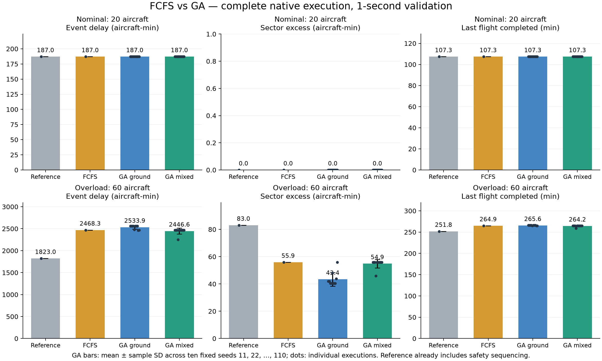

# FCFS and GA: two-case ten-seed experiment

These are synthetic stand-to-stand simulations, retaining 11 arrivals + 9 departures in the nominal case and 36 arrivals + 24 departures in overload. All arrivals start airborne and moving. No holding circuits are introduced.

## Comparison design

- Reference: existing safety-sequenced scenario, without additional ATFM regulation.
- FCFS: retain fixed requested readiness order after committed surface aircraft; assign the earliest available ground-delay action that adds no sampled safety violation or additional sector excess beyond committed traffic.
- GA ground: optimize departure CTOT delays and the order of aircraft still parked. This is the main comparison with FCFS.
- GA mixed: also allow 1/2/3/5/10/15% speed reduction on eligible Centre arrival legs, including coordinated changes to a route cohort. Its advantage includes a broader action set.
- Both use the same initial states, routes, altitude profiles, sector capacities, native surface controller, 0/1/2/…/60 minute departure-delay domain and cost weights. Aircraft already taxiing or holding retain priority.
- Hybrid GA: sequence swaps for parked departures, route-cohort crossover, coordinated arrival mutation, one-minute local refinement and diversity restarts. Population 60, up to 120 generations, at most 6,000 fast objective calls per method/seed including fine/coarse FCFS warm starts; ten fixed seeds 11, 22, …, 110.
- Native feedback: up to four separately counted complete execution checkpoints per method/seed, including warm starts. A local execution-error estimate guides subsequent search. The final plan is chosen by measured native objective, retaining a native-tested FCFS fallback. Fast-call counts alone do not represent total computation.
- Prediction: native one-second arrival trajectories and one-second arrival-pair checks; 20-second occupancy/mixed-pair screening. Every final seed is measured in complete one-second native execution. Safety metering can extend CTOT holds or withdraw speed proposals; all such changes count in the final results.
- Native delay cost = ground-delay minutes + 2 × arrival-delay minutes. Objective = cost + 10,000 × sector excess aircraft-minutes once safety violations have been eliminated.
- Capacity excess integrates max(occupancy − capacity, 0) over each sector and time. It is not the total aircraft count on the screen.

- Runway release: next arrival outside 6 NM at roll start, full previous-arrival runway evacuation, and more than 30 seconds from wheel-off to next touchdown. Mixed arrival/departure pairs use 5 NM or 1,000 ft when both are within 40 NM and at or below 10,000 ft; Centre and other pair types retain 10/20 NM. These are common simulation assumptions for every method.

## Executed results

GA entries are mean ± sample standard deviation over all saved seeds. FCFS and reference are deterministic. Event delay uses fixed departure requested ready-events and uncontrolled arrival touchdown times from identical initial states. FCFS is the better native objective of 1-minute and 5-minute grids.

| Case | Method | Event delay (aircraft-min) | Sector excess (aircraft-min) | Cost (units) | Runway events in first 3h | Safe runs |
|---|---|---:|---:|---:|---:|---:|
| Nominal (20) | Reference | 187.00 ± 0.00 | 0.00 ± 0.00 | 187.00 ± 0.00 | 20.0/20 | 1/1 |
| Nominal (20) | FCFS | 187.00 ± 0.00 | 0.00 ± 0.00 | 187.00 ± 0.00 | 20.0/20 | 1/1 |
| Nominal (20) | GA ground | 187.00 ± 0.00 | 0.00 ± 0.00 | 187.00 ± 0.00 | 20.0/20 | 10/10 |
| Nominal (20) | GA mixed | 187.00 ± 0.00 | 0.00 ± 0.00 | 187.00 ± 0.00 | 20.0/20 | 10/10 |
| Overload (60) | Reference | 1823.00 ± 0.00 | 83.05 ± 0.00 | 1823.00 ± 0.00 | 50.0/60 | 1/1 |
| Overload (60) | FCFS | 2468.33 ± 0.00 | 55.88 ± 0.00 | 2468.33 ± 0.00 | 46.0/60 | 1/1 |
| Overload (60) | GA ground | 2533.93 ± 44.68 | 43.38 ± 4.98 | 2533.93 ± 44.68 | 45.3/60 | 10/10 |
| Overload (60) | GA mixed | 2446.56 ± 68.85 | 54.88 ± 3.18 | 2449.88 ± 58.34 | 46.1/60 | 10/10 |



## Interpretation

- Nominal, GA ground versus FCFS: 0.00 fewer sector-excess aircraft-minutes; +0.00 event-delay aircraft-minutes (GA minus FCFS).
- Nominal, GA mixed versus FCFS: 0.00 fewer sector-excess aircraft-minutes; +0.00 event-delay aircraft-minutes (GA minus FCFS).
- Nominal FCFS exhausted the 60-minute proposal domain for 0 departures; native safety metering still applies. Best native replays: TEAM_GROUND_11, TEAM_MIXED_11.
- Nominal mixed GA executed 0 arrival speed controls across all saved seeds; 0 proposed speed controls were withdrawn by native spacing checks.
- Nominal: 80 native checkpoints across all GA runs; 219 diversity restarts.
- Nominal: primary FCFS is FCFS_FINE, selected by the lower native objective of the one-minute and five-minute grids.
- Nominal, GA ground: 0/10 seeds improved after initialization; mean objective improvement 0.00. This includes local search and native feedback; it does not isolate individual genetic operators.
- Nominal, GA mixed: 0/10 seeds improved after initialization; mean objective improvement 0.00. This includes local search and native feedback; it does not isolate individual genetic operators.
- Overload, GA ground versus FCFS: 12.50 fewer sector-excess aircraft-minutes; +65.60 event-delay aircraft-minutes (GA minus FCFS).
- Overload, GA mixed versus FCFS: 1.01 fewer sector-excess aircraft-minutes; -21.77 event-delay aircraft-minutes (GA minus FCFS).
- Overload FCFS exhausted the 60-minute proposal domain for 7 departures; native safety metering still applies. Best native replays: TEAM_GROUND_33, TEAM_MIXED_44.
- Overload mixed GA executed 4 arrival speed controls across all saved seeds; 0 proposed speed controls were withdrawn by native spacing checks.
- Overload: 80 native checkpoints across all GA runs; 80 diversity restarts.
- Overload: primary FCFS is FCFS_FINE, selected by the lower native objective of the one-minute and five-minute grids.
- Overload, GA ground: 9/10 seeds improved after initialization; mean objective improvement 124917.74. This includes local search and native feedback; it does not isolate individual genetic operators.
- Overload, GA mixed: 1/10 seeds improved after initialization; mean objective improvement 10068.45. This includes local search and native feedback; it does not isolate individual genetic operators.

Nominal is a no-unnecessary-intervention check. In the revised overload design, arrivals alone are capacity-feasible; excess is created by the overlay with departures. Residual capacity excess must be reported even when separation and runway protection pass. A lower delay alone does not mean a better solution if capacity excess increases. Ten seeds and two constructed cases do not establish statistical significance or general operational superiority.

All executed trials have zero spatial separation, runway-protection and arrival-transfer violation pairs. The simulator retains at least 120-second takeoff separation, full landing-runway evacuation, a 6 NM cutoff at takeoff-roll start and 30 seconds from wheel-off to next touchdown, at most four active surface departures (one on the runway), and zero airborne holding circuits. Capacity feasibility is a separate outcome.

## Files and reproduction

- [Comparison CSV](comparison.csv): executed means and sample SD for each method.
- [Every executed trial](all_native_trials.csv): individual seed metrics and repaired-control counts.
- [Complete result snapshot](results_snapshot.json): settings, input hashes, search evidence, native trials and limitations.
- Each immutable scenario run folder contains native_trials/<trial>/execution_flights.csv with proposed/executed controls, CTOT/TOBT/off-block and per-flight delay. The fcfs/, team_ground/ and team_mixed/ folders retain loadable best replays; best replay selection is by native objective, while the table uses all seeds.

```powershell
.\.venv\Scripts\python.exe -m pip install -r requirements-study.txt  # optional figures
.\.venv\Scripts\python.exe scripts/run_full_route_studies.py --seeds 11 22 33 44 55 66 77 88 99 110 --population 60 --generations 120 --max-evaluations 6000
.\.venv\Scripts\python.exe scripts/report_fcfs_ga_comparison.py
```

Open /case-scenarios for the comparison. Load Reference, FCFS, GA ground or GA mixed directly from Scenario Builder or Supervisor. Plans are tied to scenario input hashes; changing the case requires a new run.
A trajectory-table cache was reused for the development overload run where recorded in settings. Reproduction without the cache builds the same deterministic tables; reported elapsed time is not a controlled runtime benchmark.

- workbook_low_20: `20261031T023558Z-9f40de82`; evaluator `full-route-ready-bank-ga-9`; elapsed 98.2s.
- workbook_peak_50: `20261031T023600Z-dbf5f3f6`; evaluator `full-route-ready-bank-ga-9`; elapsed 1624.6s.
