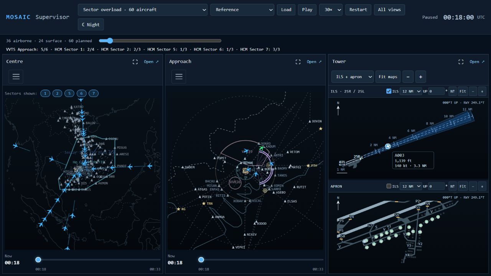
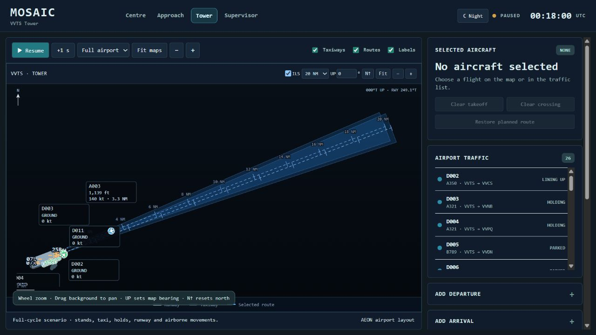

# CHƯƠNG 4
# KẾT QUẢ NGHIÊN CỨU VÀ THẢO LUẬN

Chương này trình bày kết quả đánh giá các biện pháp điều tiết luồng không lưu trong mô hình mô phỏng Tân Sơn Nhất bằng thuật toán di truyền. Hai tình huống được xem xét gồm kịch bản danh định và kịch bản quá tải. Các phương án được thực thi trên cùng hệ thống Centre, Approach và Tower để so sánh mức vượt năng lực sector, chậm trễ bổ sung và việc đáp ứng các quy tắc giãn cách đã thiết lập.

Kết quả cho thấy cấu hình GA có thể giảm phần vượt năng lực so với FCFS trong kịch bản quá tải, đồng thời làm tăng chậm trễ của một số chuyến bay. Vì vậy, hiệu quả được phân tích như một sự đánh đổi giữa mức độ quá tải và chậm trễ. Các kết luận trong chương gắn với dữ liệu xây dựng cho nghiên cứu và bộ giả định của mô phỏng.

## 4.1 Kết quả nghiên cứu

### 4.1.1 Thiết lập mô phỏng và phương pháp đánh giá

#### Phạm vi hệ thống và dữ liệu

Mô hình kết nối ba phạm vi điều hành. Centre thể hiện luồng tàu bay trên các đường bay dẫn vào khu vực Tân Sơn Nhất; Approach tiếp nhận tàu bay và tổ chức tiếp cận; Tower mô phỏng đường băng, đường lăn và vị trí đỗ. Đối với tàu bay đến, quá trình quan sát bắt đầu khi tàu bay đã ở trên không và kết thúc sau khi hạ cánh, lăn vào vị trí đỗ. Đối với tàu bay đi, mô hình bao gồm chờ tại vị trí đỗ, lăn, chờ đường băng, cất cánh và rời phạm vi theo dõi. Phạm vi này cho phép đo cả ảnh hưởng trên không và ảnh hưởng lên hoạt động mặt đất.

@source Nguồn: cấu trúc mô hình MOSAIC được sử dụng trong nghiên cứu.

Bộ dữ liệu được xây dựng từ bảng VVTS_scenarios do nhóm cung cấp và được bổ sung thời điểm, đường bay, trạng thái ban đầu cùng các thông tin mặt đất cần thiết. Đây là các kịch bản tổng hợp có điều chỉnh phục vụ thực nghiệm, không phải bản ghi đầy đủ của một ngày khai thác thực tế. Thời gian trên lịch mô phỏng là mốc quy ước để đồng bộ các chuyến bay, không phản ánh nhu cầu khai thác thực tế của sân bay vào ngày tương ứng.

Hai kịch bản giữ nguyên số tàu bay và các đặc điểm đầu vào khi chuyển giữa các phương pháp. Tất cả tàu bay đến đều hiện diện và chuyển động ngay từ đầu. Một tàu bay đi đã ở trạng thái chuẩn bị trên đường băng, các tàu bay đi còn lại ở vị trí đỗ và được đưa vào hàng chờ theo điều kiện sẵn sàng cùng khả năng tiếp nhận của mặt đất. Số tàu bay đi đang tham gia hàng chờ mặt đất được giới hạn ở bốn, trong đó tối đa một tàu bay trên đường băng. Nhờ đó, quá tải trên không không bị thể hiện bằng việc tập trung toàn bộ tàu bay đi tại điểm chờ.

@table Bảng 4.1 Đặc điểm hai kịch bản nghiên cứu
| Đặc điểm | Danh định | Quá tải |
|---|---|---|
| Tổng số tàu bay | 20 | 60 |
| Tàu bay đến | 11 | 36 |
| Tàu bay đi | 9 | 24 |
| Cửa sổ báo cáo ban đầu | 180 phút | 180 phút |
| Tàu bay đến có mặt từ đầu | 11 | 36 |
| Tàu bay đi đã chuẩn bị trên đường băng | 1 | 1 |
| Tàu bay đi còn ở vị trí đỗ | 8 | 23 |
| Số tàu bay thực hiện vòng chờ trên không | 0 | 0 |

@source Nguồn: cấu hình và trạng thái ban đầu của hai kịch bản.

Trong kịch bản quá tải, luồng đến được phân bố trên W1 qua AC và LKH, BIBAN–BITIS, PTH–BAOMY, SAPEN phía tây, NIXIV–VICAL và VTV. Số tàu bay trên các nhóm này lần lượt là 8, 7, 8, 5, 3, 3 và 2. Các đường ra của tàu bay đi gồm KADUM–BMT, LANHI–ELSAS, XOBAV–NIXIV, ANTRI–DOVIN và ANTRI–PTH, với số lượng tương ứng 8, 7, 3, 3 và 3. Cách phân bố này tạo nhiều điểm nhập và hướng thoát, thay vì dồn toàn bộ lưu lượng vào một nhánh đường bay.

#### Năng lực và quy tắc chung

Năng lực trong thực nghiệm được biểu diễn bằng số tàu bay đang bay đồng thời thuộc từng sector. Một tàu bay chỉ được tính vào sector đang chứa nó theo ranh giới ngang và lớp độ cao đã lưu. Khu vực Approach trong bán kính 40 NM được ưu tiên khi xác định phạm vi đếm. Tàu bay trên mặt đất và tàu bay ở sector khác không được cộng vào giới hạn của sector đang xét. Do đó, tổng số biểu tượng hiện trên màn hình radar có thể lớn hơn năng lực một sector mà chưa tạo ra vượt năng lực tại sector đó.

@table Bảng 4.2 Năng lực sector giả định trong thực nghiệm
| Sector | Năng lực đồng thời | Đơn vị |
|---|---|---|
| VVTS Approach | 6 | Tàu bay đang bay |
| HCM S1 | 4 | Tàu bay đang bay |
| HCM S2 | 3 | Tàu bay đang bay |
| HCM S5 | 3 | Tàu bay đang bay |
| HCM S6 | 3 | Tàu bay đang bay |
| HCM S7 | 3 | Tàu bay đang bay |

@source Nguồn: bộ tham số nghiên cứu. Các giá trị là giả định mô phỏng, không phải năng lực công bố của cơ sở điều hành.

Đại lượng ở Bảng 4.2 không quy đổi trực tiếp thành số chuyến đến trong một giờ. Giới hạn đồng thời được dùng để xác định khoảng thời gian nhiều tàu bay cùng hiện diện trong một vùng trách nhiệm và đo ảnh hưởng của điều tiết theo toàn bộ quỹ đạo.

Tất cả phương pháp sử dụng chung quy tắc bảo vệ đường băng và giãn cách. Trong mô hình, tàu bay đi chỉ bắt đầu chạy đà khi tàu bay đến trước đã thoát hoàn toàn khỏi đường băng, tàu bay đến tiếp theo còn ngoài 6 NM và thời điểm rời đất dự kiến cách lần chạm bánh tiếp theo hơn 30 giây. Khoảng cách giữa hai lần cất cánh tối thiểu là 120 giây. Các ngưỡng này là điều kiện của thực nghiệm và được giữ giống nhau trong so sánh.

Giãn cách trên không được kiểm tra theo loại cặp tàu bay và phạm vi hoạt động. Chính sách Centre sử dụng các ngưỡng nghiên cứu 10/20 NM; cặp đến–đi trong khu vực terminal sử dụng 5 NM hoặc 1.000 ft khi cả hai nằm trong 40 NM và không cao hơn 10.000 ft. Các cặp còn lại tiếp tục tuân theo chính sách tương ứng. Khoảng thời gian chuyển giao tàu bay đến tối thiểu là 120 giây. Việc không phát hiện vi phạm theo các kiểm tra này chỉ có ý nghĩa trong phạm vi mô hình đã thiết lập.

@source Nguồn: ảnh chụp giao diện MOSAIC, phương án tham chiếu của kịch bản quá tải; ảnh minh họa tổ chức quan sát, không thay cho bảng kết quả định lượng.

#### Phương pháp đối chứng và biến quyết định

Phương án tham chiếu giữ lịch đã được mô hình sắp xếp theo quy tắc an toàn, chưa bổ sung điều tiết ATFM của thực nghiệm. Vì bản thân lịch tham chiếu đã chứa chờ và sắp xếp đường băng, chậm trễ bổ sung bằng không không đồng nghĩa tàu bay được khai thác hoàn toàn không phải chờ.

FCFS duy trì thứ tự cất cánh an toàn sớm nhất theo thời điểm sẵn sàng trong mô hình và lần lượt chọn mức giữ đất sớm nhất phù hợp với các kiểm tra dự báo. GA mặt đất tìm kiếm mức giữ đất, đồng thời cho phép đổi thứ tự các tàu bay đi còn ở vị trí đỗ. GA kết hợp mở rộng thêm điều chỉnh tốc độ trên các đoạn Centre đủ điều kiện của tàu bay đến. Tàu bay đã lăn hoặc đã tham gia thứ tự cam kết tiếp tục được ưu tiên theo bộ giải mã.

@table Bảng 4.3 Các phương án so sánh
| Phương án | Điều tiết giữ đất | Đổi thứ tự tàu bay còn đỗ | Điều chỉnh tốc độ tàu bay đến |
|---|---|---|---|
| Tham chiếu | Không bổ sung | Theo lịch tham chiếu | Không bổ sung |
| FCFS | Có | Không tối ưu lại | Không |
| GA mặt đất | Có | Có | Không |
| GA kết hợp | Có | Có | Có khi đủ điều kiện |

Miền giữ đất đề xuất là 0–60 phút, bước một phút. Miền giảm tốc độ là 0, 1, 2, 3, 5, 10 và 15%. Không phải mọi tàu bay đều có toàn bộ các lựa chọn này: tàu bay đến đã ở trên không không nhận biện pháp giữ đất; điều chỉnh tốc độ chỉ được xét trên phần quỹ đạo phù hợp. Đường bay, cấu hình năng lực và số tàu bay không phải biến được GA tự do thay đổi trong các thực nghiệm này.

So sánh GA mặt đất với FCFS là so sánh chính giữa các cấu hình có cùng nhóm biện pháp giữ đất. So sánh GA kết hợp với FCFS đánh giá lợi ích của cả cách tìm kiếm lẫn việc bổ sung biện pháp trên không. Vì phạm vi điều khiển khác nhau, không thể quy toàn bộ mức cải thiện của GA kết hợp cho riêng các toán tử di truyền.

#### Chỉ tiêu đánh giá và cấu hình thuật toán

Chậm trễ của từng tàu bay được đo bằng phần tăng dương của thời điểm thực thi so với phương án tham chiếu. Sự kiện được dùng là cất cánh đối với tàu bay đi và chạm bánh đối với tàu bay đến. Tổng chậm trễ bổ sung được tính theo công thức (4.1), trong đó các thời điểm sử dụng đơn vị giây và kết quả quy đổi sang phút.

@equation delay 4.1

Trong công thức (4.1), N là số tàu bay; tᵢ là thời điểm sự kiện sau thực thi; tᵢ⁽⁰⁾ là thời điểm tương ứng trong phương án tham chiếu. Tổng được báo cáo bằng tàu bay-phút. Chỉ tiêu này tách biệt với tổng thời gian đỗ, tổng thời gian lăn và chậm trễ so với thời điểm yêu cầu ban đầu của bảng dữ liệu.

Phần vượt năng lực được tích lũy trên từng sector và toàn bộ thời gian mô phỏng theo công thức (4.2). Trong đó nₛ(t) là số tàu bay đang bay thuộc sector s tại thời điểm t; Cₛ là năng lực của sector; T là thời điểm kết thúc quá trình đánh giá. Hệ số 1/60 chuyển giây sang phút.

@equation excess 4.2

Ví dụ, một tàu bay vượt giới hạn trong năm phút và hai tàu bay vượt giới hạn trong hai phút tạo tổng cộng chín tàu bay-phút vượt năng lực. Chỉ tiêu E phản ánh đồng thời mức độ và thời gian quá tải; nó cung cấp thông tin khác với chỉ báo đỉnh lớn nhất. Trong triển khai, tích phân được xấp xỉ bằng tổng mẫu theo thời gian.

Với các phương án đáp ứng kiểm tra giãn cách và đường băng của mô hình, giá trị đánh giá thực thi sử dụng công thức (4.3). Dđi và Dđến lần lượt là tổng chậm trễ bổ sung của tàu bay đi và tàu bay đến. Các hệ số là trọng số quy ước của nghiên cứu, không phải chi phí nhiên liệu hay chi phí tiền tệ đã được hiệu chỉnh từ thực tế.

@equation objective 4.3

Trọng số 10.000 đặt ưu tiên lớn vào giảm phần vượt năng lực. Vì vậy, thuật toán có thể chấp nhận tăng thời gian chờ của tàu bay đi để giảm E. Tuy nhiên, đây vẫn là thành phần phạt hữu hạn, không phải bảo đảm mọi sector luôn dưới giới hạn. Trong quá trình tìm kiếm, các vi phạm giãn cách, đường băng và thứ tự cam kết còn chịu một thành phần phạt riêng; kết quả công bố được lựa chọn sau khi thực thi lại trong mô phỏng.

@table Bảng 4.4 Cấu hình GA và ngân sách đánh giá
| Tham số | Giá trị sử dụng |
|---|---|
| Kích thước quần thể | 60 cá thể |
| Số thế hệ tối đa | 120 |
| Số đánh giá nhanh tối đa | 6.000 cho mỗi phương pháp và seed |
| Số lần kiểm tra thực thi tối đa | 4 cho mỗi phương pháp và seed, đếm riêng |
| Seed ngẫu nhiên | 11, 22, 33 |
| Chọn lọc | Tournament, ba ứng viên |
| Bảo toàn cá thể | Khoảng 10%, tối thiểu hai cá thể |
| Khởi tạo | FCFS bước một phút, FCFS bước năm phút và các biến thể |
| Toán tử tìm kiếm | Đổi thứ tự tại sân đỗ, lai theo nhóm tuyến, đột biến tốc độ phối hợp, tinh chỉnh giữ đất |
| Duy trì đa dạng | Khởi động lại sau mười thế hệ không cải thiện dự báo |
| Kiểm tra cuối cùng | Thực thi quỹ đạo và kiểm tra ở bước một giây |

Đánh giá nhanh sử dụng mẫu 20 giây cho lượng chiếm dụng và một số kiểm tra cặp; quỹ đạo cùng kiểm tra cặp tàu bay đến được tính ở bước một giây. Các nghiệm được chọn tiếp tục được thực thi bằng bộ điều khiển mặt đất và trên không của mô hình. Kết quả thực thi có thể khác dự báo do thời điểm nhả đường băng, hàng chờ và điều chỉnh an toàn. Do đó, bảng kết quả chính sử dụng số đo sau thực thi, còn lịch sử dự báo chỉ phục vụ phân tích quá trình tìm kiếm.

Với GA, mỗi cấu hình được chạy theo ba seed và báo cáo trung bình cùng độ lệch chuẩn mẫu. Phương án tham chiếu và FCFS là tất định trong bộ đầu vào đang xét. Đường biểu diễn của một replay được ghi rõ là ví dụ lựa chọn; không được coi đường đó là kết quả trung bình của ba lần chạy.

### 4.1.2 Kết quả kịch bản danh định

Kịch bản danh định sử dụng 11 tàu bay đến và 9 tàu bay đi. Mục đích của kịch bản là kiểm tra xem bộ điều tiết có giữ được trạng thái không cần can thiệp hay không khi nhu cầu đã nằm trong giới hạn mô hình. Đây là bước kiểm tra cần thiết vì một thuật toán gây giữ đất hoặc giảm tốc khi không có lợi ích về năng lực sẽ tạo thêm chậm trễ không cần thiết.

@table Bảng 4.5 Kết quả thực thi trong kịch bản danh định
| Phương án | Chậm trễ bổ sung tàu bay-phút | Vượt năng lực tàu bay-phút | Sự kiện cất hạ cánh trong 180 phút |
|---|---|---|---|
| Tham chiếu | 0,00 | 0,00 | 20/20 |
| FCFS | 0,00 | 0,00 | 20/20 |
| GA mặt đất | 0,00 ± 0,00 | 0,00 ± 0,00 | 20/20 |
| GA kết hợp | 0,00 ± 0,00 | 0,00 ± 0,00 | 20/20 |

@source Nguồn: kết quả thực thi mô phỏng; các giá trị GA tổng hợp ba seed.

Cả bốn phương án đều không tạo thêm chậm trễ và không có phần vượt năng lực tích lũy. Trong trường hợp này, tổng chi phí và thành phần phạt đều bằng không nên GA có thể dừng ngay tại thế hệ khởi tạo. Việc dừng sớm phù hợp với cấu trúc hàm mục tiêu không âm: không thể tìm được giá trị nhỏ hơn không trong bài toán đang xét. Kết quả này không chứng minh GA luôn tối ưu toàn cục ở các kịch bản khác.

Hình 4.3 cho thấy diễn biến lượng tàu bay trong Approach không vượt đường năng lực sáu tàu bay. Các phương án giữ nguyên kế hoạch khi không cần điều tiết, nên các đường biểu diễn chồng lên nhau. Tương tự, kết quả kiểm tra các sector Centre không ghi nhận phần vượt năng lực. Toàn bộ hành trình mô hình hoàn tất sau khoảng 107,35 phút, bao gồm lăn vào vị trí đỗ của tàu bay đến và kết thúc phần hành trình theo dõi của tàu bay đi.

Giá trị không ở Bảng 4.5 chỉ là chậm trễ bổ sung so với lịch tham chiếu. Tàu bay vẫn cần thời gian chuẩn bị, chờ điều kiện đường băng và lăn. Vì vậy, kết quả danh định được hiểu là bộ điều tiết không làm xấu thêm kế hoạch đã khả thi, thay vì hiểu là sân bay không có bất kỳ thời gian chờ nào.

@source Nguồn: tái tính từ quỹ đạo thực thi một giây; các đường tham chiếu FCFS và GA kết hợp trùng nhau.

@source Nguồn: giao diện MOSAIC; ảnh minh họa quan sát tiếp cận và trạng thái tàu bay, không phải số đo trung bình của thực nghiệm.

Màn hình Tower hỗ trợ quan sát tàu bay tiếp cận trên phần kéo dài trục đường băng, đồng thời giữ thông tin tàu bay đang đỗ hoặc chờ cất cánh. Việc hiển thị này giúp kiểm tra diễn biến điều tiết: một tàu bay đi có thể đã chuẩn bị trên đường băng nhưng vẫn chờ đến khi các điều kiện nhả được đáp ứng. Hành vi chờ vì an toàn được phân biệt với giữ đất bổ sung do phương án ATFM.

Một ví dụ trong lịch tham chiếu danh định cho thấy tàu bay đến A009 thoát đường băng tại giây 2.042. D001 bắt đầu chạy đà tại giây 2.045 và rời đất tại giây 2.100. Khi bắt đầu chạy đà, A006 còn cách ngưỡng chạm bánh khoảng 7,66 NM; A006 chạm bánh tại giây 2.241, tức 141 giây sau khi D001 rời đất. Ví dụ này minh họa khả năng tận dụng khoảng trống giữa hai lần hạ cánh mà vẫn thỏa các điều kiện chung của mô hình.

### 4.1.3 Kết quả kịch bản quá tải

Kịch bản quá tải gồm 36 tàu bay đến đã ở trên không và 24 tàu bay đi. Quá tải được xác định bằng lượng chiếm dụng vượt năng lực trong một hoặc nhiều sector, không phải chỉ vì có 60 tàu bay trong toàn bộ kịch bản. Các luồng bay có thể phân bố trên nhiều vùng trách nhiệm nhưng vẫn tập trung tại một số sector và giai đoạn chuyển tiếp.

Trong phương án tham chiếu, tổng phần vượt năng lực là 46,18 tàu bay-phút. Giá trị chậm trễ bổ sung bằng không vì đây là chính mốc so sánh. Hai giá trị này không mâu thuẫn: kế hoạch tham chiếu có thể đáp ứng quy tắc giãn cách của mô hình nhưng vẫn vượt giới hạn năng lực đã giả định. FCFS và các cấu hình GA phải lựa chọn mức điều tiết để thay đổi sự phân bố lưu lượng này.

@table Bảng 4.6 Kết quả thực thi kịch bản quá tải
| Phương án | Chậm trễ bổ sung tàu bay-phút | Vượt năng lực tàu bay-phút | Giá trị J đơn vị quy ước |
|---|---|---|---|
| Tham chiếu | 0,00 | 46,18 | 461.833,33 |
| FCFS | 518,37 | 28,32 | 283.685,03 |
| GA mặt đất | 626,37 ± 0,00 | 19,98 ± 0,00 | 200.459,70 ± 0,00 |
| GA kết hợp | 555,07 ± 123,49 | 19,25 ± 1,27 | 193.057,11 ± 12.821,67 |

@source Nguồn: thực thi đầy đủ mô phỏng. Các giá trị trung bình và độ lệch chuẩn GA được tính trên cả ba seed, không chỉ replay tốt nhất.

FCFS làm giảm phần vượt năng lực từ 46,18 xuống 28,32 tàu bay-phút bằng cách điều tiết tàu bay đi theo thứ tự. GA mặt đất tiếp tục giảm xuống 19,98 tàu bay-phút nhưng tổng chậm trễ bổ sung tăng lên 626,37 tàu bay-phút. Cấu hình GA kết hợp có kết quả trung bình 19,25 tàu bay-phút vượt năng lực và 555,07 tàu bay-phút chậm trễ bổ sung. Xét theo hàm mục tiêu đã chọn, các cấu hình GA được ưu tiên vì giảm được phần vượt năng lực với trọng số lớn.

@source Nguồn: tổng hợp kết quả thực thi. Thanh sai số của GA là độ lệch chuẩn mẫu qua ba seed.

Hình 4.5 cho thấy hướng biến động của hai chỉ tiêu khác nhau. Phương án tham chiếu có chậm trễ bổ sung thấp nhất theo định nghĩa nhưng mức quá tải lớn nhất. GA mặt đất giảm quá tải mạnh hơn FCFS và đồng thời tạo thêm thời gian chờ. GA kết hợp có thể sử dụng tốc độ của các tàu bay đến để tạo phương án phối hợp tốt hơn, song khả năng này không xuất hiện với mức hiệu quả giống nhau trong mọi seed.

@source Nguồn: quỹ đạo thực thi; GA mặt đất dùng seed 11 và GA kết hợp dùng seed 33 là các replay được chọn theo J thực thi. Đây không phải đường trung bình. Vạch 180 phút đánh dấu cuối cửa sổ báo cáo ban đầu.

Các đường ở Hình 4.6 được kéo dài qua cửa sổ 180 phút nhằm quan sát phần lưu lượng bị dời về cuối kỳ. Nếu chỉ đo quá tải trong ba giờ đầu rồi bỏ qua phần sau, phương án trì hoãn có thể được đánh giá thuận lợi một cách sai lệch. Thực nghiệm do đó tiếp tục mô phỏng cho đến khi hoàn tất toàn bộ hành trình, đồng thời giữ riêng chỉ tiêu số sự kiện đường băng xảy ra trong 180 phút.

#### Phân bố quá tải theo sector

Tổng phần vượt năng lực cần được phân rã để nhận biết vị trí tác động của biện pháp. Bảng 4.7 sử dụng các replay đã chọn để minh họa sự thay đổi theo sector. Tổng của cột GA kết hợp trong bảng là kết quả của seed 33, khác với giá trị trung bình 19,25 ở Bảng 4.6.

@table Bảng 4.7 Phần vượt năng lực theo sector của các replay minh họa
| Sector | Tham chiếu | FCFS | GA mặt đất seed 11 | GA kết hợp seed 33 |
|---|---|---|---|---|
| Approach | 8,80 | 1,38 | 1,15 | 1,15 |
| HCM S1 | 0,00 | 0,00 | 0,00 | 0,00 |
| HCM S2 | 17,32 | 8,10 | 0,00 | 0,00 |
| HCM S5 | 0,00 | 0,00 | 0,00 | 0,00 |
| HCM S6 | 17,08 | 17,08 | 17,08 | 15,05 |
| HCM S7 | 2,98 | 1,75 | 1,75 | 1,58 |
| Tổng | 46,18 | 28,32 | 19,98 | 17,78 |

@source Nguồn: kiểm tra lượng chiếm dụng một giây; đơn vị tàu bay-phút. Tổng tính từ số liệu chưa làm tròn.

@source Nguồn: cùng các replay và đơn vị với Bảng 4.7.

Tại HCM S2, giữ đất và sắp xếp lại tàu bay đi làm phần vượt năng lực giảm từ 17,32 ở tham chiếu xuống 8,10 với FCFS và bằng không trong các replay GA được chọn. Ngược lại, HCM S6 còn 17,08 tàu bay-phút vượt năng lực khi chỉ điều tiết mặt đất. Kết quả này cho thấy một biện pháp có thể hữu ích đối với sector chịu ảnh hưởng của tàu bay đi nhưng ít tác động đến phần quá tải từ các tàu bay đến đã ở trên không.

Trong replay GA kết hợp seed 33, phần vượt năng lực HCM S6 giảm còn 15,05 tàu bay-phút và đỉnh lượng chiếm dụng giảm từ năm xuống bốn tàu bay. Tuy nhiên, năng lực tại đây vẫn là ba tàu bay nên quá tải chưa được loại bỏ. Tại Approach, phần vượt năng lực vẫn còn 1,15 tàu bay-phút và đỉnh vẫn có thể đạt bảy tàu bay. Việc báo cáo cả diện tích vượt và giá trị đỉnh tránh diễn giải rằng giảm tổng E đồng nghĩa mọi thời điểm đều đã đạt giới hạn.

### 4.1.4 So sánh phương pháp đối chứng và phương án GA

So với FCFS, GA mặt đất giảm 8,33 tàu bay-phút vượt năng lực, tương đương 29,43%, nhưng làm tăng 108,00 tàu bay-phút chậm trễ bổ sung, tương đương 20,83%. GA kết hợp giảm trung bình 9,07 tàu bay-phút vượt năng lực, tương đương 32,02%, trong khi chậm trễ tăng trung bình 36,71 tàu bay-phút, tương đương 7,08%. Các tỷ lệ này dùng cùng mốc FCFS và cùng kết quả sau thực thi.

Như vậy, không có căn cứ kết luận GA đồng thời giảm mọi dạng chậm trễ và quá tải trong bộ thực nghiệm này. Kết quả phù hợp với cách đặt trọng số của hàm mục tiêu: giảm quá tải được ưu tiên, còn chậm trễ là chi phí phải theo dõi khi thực hiện điều tiết. Nếu thay đổi mức ưu tiên giữa hai thành phần, phương án được lựa chọn cũng có thể thay đổi; nghiên cứu hiện tại chưa thực hiện phân tích độ nhạy đầy đủ của trọng số.

#### Chậm trễ của từng tàu bay

Tổng chậm trễ không cho biết mức độ tập trung gánh nặng lên từng chuyến. Hình 4.8 biểu diễn phân bố tích lũy của chậm trễ bổ sung trong các replay dùng để minh họa. Trục ngang là số phút chậm trễ của một tàu bay; trục dọc là tỷ lệ tàu bay có chậm trễ không vượt giá trị đó. Đường tăng mạnh tại gốc cho biết nhiều tàu bay giữ nguyên thời điểm sự kiện so với tham chiếu.

Giới hạn 60 phút áp dụng cho mức giữ đất đề xuất của bộ tối ưu. Chậm trễ sau thực thi có thể lớn hơn mức đề xuất do còn chịu điều kiện đường băng và hàng chờ. Trong các replay FCFS và GA mặt đất, chậm trễ bổ sung lớn nhất là 82 phút. Sự khác biệt này là lý do kết quả được đo từ thời điểm thực thi, thay vì cộng trực tiếp các mức giữ đất trong nhiễm sắc thể.

@source Nguồn: dữ liệu thời điểm sự kiện sau thực thi; FCFS, GA mặt đất seed 11 và GA kết hợp seed 33. Các đường là phân bố của từng replay, không phải khoảng tin cậy.

Trong replay GA kết hợp seed 33, tổng chậm trễ là 412,48 tàu bay-phút, thấp hơn FCFS; trong khi hai seed còn lại có kết quả bằng GA mặt đất. Do đó, một hình minh họa dùng seed tốt nhất có thể tạo ấn tượng thuận lợi hơn kết quả trung bình. Bảng 4.6 và phân tích giữa các seed được giữ làm cơ sở kết luận chính; Hình 4.8 chỉ giúp giải thích cấu trúc phân bố của một phương án cụ thể.

Độ lệch chuẩn chậm trễ giữa 60 tàu bay của replay FCFS là khoảng 19,50 phút, của GA mặt đất seed 11 là 19,83 phút và của GA kết hợp seed 33 là 15,84 phút. Đây là các số đo mô tả trong từng replay. Chúng khác với độ lệch chuẩn 123,49 tàu bay-phút của tổng chậm trễ GA kết hợp giữa ba seed. Hai loại độ lệch chuẩn không thể dùng thay cho nhau để kết luận về tính công bằng. Hơn nữa, tính công bằng chưa là thành phần tối ưu hóa riêng trong hàm mục tiêu hiện tại.

#### Giãn cách và tiến trình hoàn tất

Các thực thi cuối cùng của hai kịch bản không ghi nhận cặp vi phạm giãn cách không gian, bảo vệ đường băng hoặc khoảng chuyển giao theo bộ kiểm tra đã cài đặt. Kết quả này có được khi mọi phương pháp đều chịu cùng cơ chế kiểm tra và điều tiết an toàn của mô hình. Nó cần được đọc cùng với phần vượt năng lực còn lại; không được đồng nhất “không ghi nhận vi phạm giãn cách” với “hoàn toàn đáp ứng năng lực”.

Trong 180 phút đầu của kịch bản quá tải, số sự kiện cất hạ cánh lần lượt là 53 ở tham chiếu, 50 ở FCFS, 49 ở GA mặt đất và trung bình 49,67 ở GA kết hợp. Đây là số sự kiện đường băng, không phải số tàu bay đã hoàn tất toàn bộ hành trình mô phỏng. Khi xét đủ hành trình của các replay minh họa, số hoàn tất trong 180 phút lần lượt là 44, 42, 42 và 42. Tàu bay đi còn tiếp tục bay sau cất cánh và tàu bay đến còn cần lăn vào vị trí đỗ.

Thời điểm hoàn tất cuối cùng của các replay tương ứng là 242,85; 252,85; 262,85 và 271,17 phút từ đầu mô phỏng. Những số đo này cho thấy điều tiết có thể đẩy thời điểm kết thúc về sau dù làm giảm E. Việc kéo dài mô phỏng qua phần đuôi giúp ghi nhận hệ quả đó, tránh đánh giá chỉ theo số chuyến được đưa ra ngoài cửa sổ báo cáo.

### 4.1.5 Độ hội tụ biến động giữa các lần chạy và thời gian tính toán

#### Kết quả giữa các seed

@table Bảng 4.8 Kết quả từng seed của GA kết hợp trong kịch bản quá tải
| Seed | Chậm trễ bổ sung tàu bay-phút | Vượt năng lực tàu bay-phút | Tàu bay được giảm tốc | Giá trị J |
|---|---|---|---|---|
| 11 | 626,37 | 19,98 | 0 | 200.459,70 |
| 22 | 626,37 | 19,98 | 0 | 200.459,70 |
| 33 | 412,48 | 17,78 | 11 | 178.251,92 |
| Trung bình | 555,07 | 19,25 | 3,67 | 193.057,11 |

@source Nguồn: kết quả thực thi của cả ba seed. Trung bình số tàu bay được giảm tốc là thống kê giữa các lần chạy, không phải số tàu bay của một kế hoạch riêng lẻ.

Hai seed 11 và 22 giữ phương án có cùng chỉ tiêu với GA mặt đất; seed 33 tìm được phương án kết hợp điều tiết mặt đất và giảm tốc của 11 tàu bay đến. Chậm trễ bổ sung của các tàu bay đến trong seed 33 là 6,10 tàu bay-phút, còn phần chậm trễ của tàu bay đi là 406,38 tàu bay-phút. Điều này cho thấy một điều chỉnh tốc độ nhỏ, khi phối hợp với lịch cất cánh và quá trình nhập sector, có thể tạo một phương án tốt hơn theo hàm mục tiêu.

Tuy nhiên, chỉ một trong ba seed đạt mức cải thiện thêm nói trên. Trung bình và độ lệch chuẩn vì thế là thông tin cần thiết để phản ánh sự biến động của quá trình tìm kiếm. Ba lần chạy đủ để minh họa bước đầu nhưng chưa đủ để thiết lập ý nghĩa thống kê hay mức tin cậy về ưu thế của thuật toán trên một tập tình huống rộng hơn.

#### Hội tụ dự báo và kiểm chứng thực thi

@source Nguồn: lịch sử tìm kiếm của ba seed trong kịch bản quá tải. Điểm thực thi chỉ cập nhật tại những lần kiểm tra đầy đủ; giá trị được giữ nguyên giữa các lần kiểm tra.

Phần trên của Hình 4.9 thể hiện điểm dự báo tốt nhất đã tìm được trong từng thế hệ. Phần dưới thể hiện điểm thực thi tốt nhất đã được kiểm chứng. Hai đường không trùng nhau vì mô hình đánh giá nhanh chưa phản ánh chính xác mọi tác động của hàng chờ mặt đất và quy tắc nhả tàu bay. Điểm dự báo giảm không bảo đảm nghiệm đó sẽ được chọn cuối cùng nếu kết quả thực thi kém hơn nghiệm đã có.

Đối với GA mặt đất, cả ba lần chạy đều giữ nghiệm đã có từ bước khởi tạo FCFS nhiều độ phân giải sau khi so sánh các lần thực thi. Các nghiệm tiến hóa được kiểm tra không thay thế được nghiệm đó. Vì vậy, mức cải thiện của cấu hình GA mặt đất so với FCFS bước một phút bao gồm lợi ích của bước khởi tạo, không phải bằng chứng tách biệt rằng riêng các toán tử di truyền đã tạo toàn bộ mức cải thiện.

Với GA kết hợp seed 33, điểm thực thi tốt nhất sau khởi tạo là 200.459,70. Nghiệm kiểm tra ở thế hệ 60 chưa tốt hơn mức này. Đến thế hệ 76, một nghiệm thực thi đạt 178.251,92 và được chọn. Diễn biến này cho thấy vai trò của kiểm chứng cuối cùng: thuật toán giữ phương án đã thực thi tốt nhất, thay vì bắt buộc chọn nghiệm có điểm dự báo thấp nhất.

#### Ngân sách đánh giá và thời gian

@table Bảng 4.9 Ngân sách đã sử dụng trong kịch bản quá tải
| Cấu hình | Seed | Đánh giá nhanh | Thế hệ cuối | Khởi động lại | Kiểm tra thực thi |
|---|---|---|---|---|---|
| GA mặt đất | 11 | 6.000 | 86 | 0 | 4 |
| GA mặt đất | 22 | 6.000 | 99 | 5 | 4 |
| GA mặt đất | 33 | 6.000 | 91 | 7 | 4 |
| GA kết hợp | 11 | 6.000 | 87 | 6 | 4 |
| GA kết hợp | 22 | 6.000 | 75 | 4 | 4 |
| GA kết hợp | 33 | 6.000 | 76 | 4 | 4 |

Tất cả lần chạy quá tải dừng do hết 6.000 lượt đánh giá nhanh trước khi đạt 120 thế hệ. Số thế hệ khác nhau do cơ chế tinh chỉnh và tạo ứng viên tiêu thụ số đánh giá khác nhau. Số lần kiểm tra thực thi được đếm riêng; vì vậy, không nên dùng riêng con số 6.000 để đại diện cho toàn bộ chi phí tính toán của một lần chạy.

Thời gian ghi nhận cho toàn bộ đợt thực nghiệm danh định khoảng 25,4 giây, còn đợt quá tải khoảng 786,8 giây, tương đương 13,1 phút. Mỗi đợt gồm chuẩn bị dữ liệu, nhiều cấu hình, ba seed và các bước kiểm chứng. Thời gian này không phải độ trễ của một quyết định điều hành trực tuyến. Việc dùng lại kết quả tính toán giống nhau giữa các lần kiểm tra cũng có thể ảnh hưởng số đo, nên chưa có cơ sở so sánh tốc độ với một hệ thống khác chỉ từ hai giá trị này.

Trong danh định, GA dừng ở thế hệ khởi tạo với số đánh giá thấp vì đã có nghiệm không chi phí và không vượt năng lực. Trong quá tải, ngân sách được sử dụng hết và vẫn còn E dương. Sự khác biệt phản ánh độ khó của đầu vào và giới hạn biện pháp, đồng thời cho thấy cần đánh giá chất lượng nghiệm cùng ngân sách tính toán, thay vì chỉ báo cáo số thế hệ được cấu hình.

## 4.2 Thảo luận

### 4.2.1 Mức độ đáp ứng mục tiêu nghiên cứu

Thực nghiệm đã tạo được một quy trình liên kết đề xuất điều tiết, thực thi quỹ đạo và đo kết quả trên cả Centre, Approach và Tower. Việc đưa tàu bay đi từ vị trí đỗ đến cất cánh và tiếp tục theo dõi tàu bay đến đến khi đỗ giúp phát hiện những khác biệt mà một mô hình chỉ dịch thời điểm đến có thể bỏ qua. Các bảng kết quả sử dụng thời điểm sau thực thi nên phản ánh tác động của bộ điều khiển chung đối với từng phương án.

Về cân bằng nhu cầu và năng lực, cấu hình GA giảm được phần vượt năng lực trong kịch bản quá tải. Về chậm trễ, kết quả trung bình không tốt hơn FCFS; lợi ích về năng lực đi kèm tăng chậm trễ bổ sung. Do đó, mục tiêu được đáp ứng ở mức tìm được cách phân bố lưu lượng phù hợp hơn với trọng số nghiên cứu, chưa phải loại bỏ toàn bộ quá tải hoặc giảm tổng chậm trễ trong mọi tình huống.

Kịch bản danh định và quá tải có vai trò bổ sung cho nhau. Danh định kiểm tra khả năng tránh can thiệp không cần thiết; quá tải kiểm tra khả năng tạo khác biệt khi có xung đột giữa nhu cầu và năng lực. Hai trường hợp cho một minh họa có kiểm soát, nhưng chưa đại diện cho mọi cấu hình khai thác của Tân Sơn Nhất.

### 4.2.2 Đánh đổi giữa giữ đất và điều chỉnh trên không

Giữ đất có thể thay đổi thời điểm tàu bay đi vào các sector và làm giảm sự trùng lặp với luồng đến. Tuy nhiên, nếu một sector đã quá tải chỉ vì các tàu bay đến đều đang bay tại thời điểm bắt đầu, giữ các tàu bay đi ở sân đỗ không thể trực tiếp loại bỏ phần quá tải đó. Điều chỉnh tốc độ mở thêm khả năng tác động lên thời điểm nhập sector, nhưng vẫn bị giới hạn bởi điều kiện áp dụng và giãn cách với các tàu bay khác.

Kết quả HCM S2 và HCM S6 minh họa sự khác biệt này. Biện pháp mặt đất đã loại bỏ phần vượt tại HCM S2 trong replay GA được chọn, trong khi HCM S6 vẫn vượt giới hạn. Khi bổ sung điều chỉnh tốc độ, seed 33 giảm thêm phần vượt HCM S6 nhưng chưa đưa sector về trạng thái hoàn toàn dưới năng lực. Cần lựa chọn biện pháp dựa trên nguồn tạo quá tải, thay vì chỉ tăng mức giữ đất cho tất cả chuyến bay.

Không có vòng chờ trên không trong hai kịch bản. Vì vậy, nghiên cứu không lượng hóa được mức giảm holding và không suy ra tiết kiệm nhiên liệu từ việc giảm holding. Các trọng số của hàm mục tiêu chỉ thể hiện ưu tiên tương đối. Để chuyển sang đánh giá kinh tế, cần bổ sung dữ liệu tiêu hao, thời gian sử dụng mặt đất và chi phí theo loại tàu bay.

### 4.2.3 Liên hệ với các nghiên cứu trước

Nghiên cứu của Hansen về tìm kiếm di truyền trong điều hành tàu bay xem xét bài toán lập lịch đến và phân bổ đường băng [8]. Mô hình ở đây mở rộng phạm vi quan sát sang các sector Centre và quá trình mặt đất tại sân bay, đồng thời giữ cố định nhiều thành phần của đường bay. Sự khác biệt về biến quyết định và chỉ tiêu đánh giá khiến các tỷ lệ cải thiện không thể so sánh trực tiếp giữa hai nghiên cứu.

Cách mã hóa theo chuyến bay và khai thác thông tin nhóm tuyến có liên hệ với hướng xây dựng biểu diễn phù hợp bài toán trong nghiên cứu của Xiao, Cai và Abbass [6]. Tuy nhiên, triển khai này không phải tái hiện thuật toán HybrID của nghiên cứu đó. Các kết quả hiện tại chỉ đánh giá cấu hình được xây dựng cho hai kịch bản MOSAIC, không chứng minh ưu thế so với các thuật toán trong tài liệu tham khảo.

Một đặc điểm của thực nghiệm là tách kết quả dự báo khỏi kết quả thực thi. Bước kiểm tra đầy đủ cho thấy một số nghiệm có dự báo tốt hơn nhưng không cải thiện kết quả khi chạy qua bộ điều khiển. Điều này củng cố yêu cầu kiểm chứng bằng mô phỏng khi đánh giá một phương án ATFM; chất lượng tìm kiếm không nên được báo cáo chỉ từ điểm thích nghi trong quá trình tiến hóa.

### 4.2.4 Giới hạn mô hình và điều kiện áp dụng

Hai kịch bản chưa được hiệu chuẩn bằng tập quỹ đạo khai thác thực tế đủ lớn. Năng lực, tốc độ và hành vi mặt đất còn là giả định. Kết quả hiện tại vì thế chưa dự báo được hiệu quả khai thác thực tế của Tân Sơn Nhất.

Mỗi cấu hình GA có ba seed; chưa có khảo sát đầy đủ theo nhu cầu, năng lực, trọng số, thời tiết và cấu hình đường băng. Đóng góp của khởi tạo, toán tử di truyền và phản hồi thực thi chưa được tách riêng.

Phạm vi điều khiển giới hạn ở giữ đất, thứ tự tàu bay đi còn đỗ và tốc độ đủ điều kiện. GA không thay năng lực, độ cao tùy ý hoặc giữ đất tàu bay đã ở trên không. Kiểm tra một giây cũng chưa bao quát đầy đủ sai số bám quỹ đạo và hành vi con người. Mô hình phù hợp để nghiên cứu, giảng dạy; ứng dụng hỗ trợ quyết định cần dữ liệu, hiệu chuẩn và thẩm định bổ sung.

# CHƯƠNG 5
# KẾT LUẬN VÀ KIẾN NGHỊ

## 5.1 Kết luận

### 5.1.1 Kết quả đồ án

Đồ án đã xây dựng và đánh giá mô hình điều tiết luồng không lưu tại Tân Sơn Nhất kết nối Centre, Approach và Tower. Mô hình theo dõi cả hoạt động trên không và mặt đất, cho phép kiểm tra kết quả của giữ đất, sắp xếp thứ tự tàu bay đi và điều chỉnh tốc độ tàu bay đến bằng cấu hình GA.

Hai kịch bản gồm danh định 20 tàu bay và quá tải 60 tàu bay. Danh định không phát sinh chậm trễ bổ sung hoặc vượt năng lực. Trong quá tải, so với FCFS, GA mặt đất giảm phần vượt năng lực 29,43% và tăng chậm trễ bổ sung 20,83%; GA kết hợp giảm phần vượt năng lực trung bình 32,02% và tăng chậm trễ bổ sung 7,08%. Các giá trị GA tổng hợp ba seed và vẫn còn quá tải.

Kết quả thể hiện sự đánh đổi theo mục tiêu đã đặt, chưa phải khả năng đồng thời giảm mọi chỉ tiêu. Các thực thi cuối không ghi nhận vi phạm giãn cách và bảo vệ đường băng theo bộ kiểm tra của mô hình. Kết luận này giới hạn trong các giả định mô phỏng.

### 5.1.2 Ưu điểm

Mô hình cho phép quan sát mối liên hệ giữa lưu lượng trên không và hàng chờ mặt đất, đếm lượng chiếm dụng đúng từng sector và ghi nhận phần lưu lượng bị dời về cuối kỳ. Các quyết định của GA có thể diễn giải theo từng chuyến bay. Việc dùng chung bộ điều khiển với đối chứng, giữ nghiệm thực thi tốt nhất và lưu kết quả từng seed giúp kiểm tra lại kết luận.

### 5.1.3 Nhược điểm

Dữ liệu và năng lực còn mang tính giả định; hai kịch bản cùng ba seed chưa đủ để khái quát hóa. GA mặt đất giữ nghiệm từ bước khởi tạo nhiều độ phân giải, còn GA kết hợp chỉ có một seed cải thiện thêm sau khởi tạo. Vì vậy, chưa thể quy toàn bộ mức cải thiện cho riêng quá trình tiến hóa. Quá tải chưa được loại bỏ hoàn toàn; đồ án cũng chưa xác định lợi ích kinh tế hoặc tiết kiệm nhiên liệu trong khai thác thực tế.

## 5.2 Kiến nghị

### 5.2.1 Hướng ứng dụng của đề tài

Mô hình phù hợp với giảng dạy, nghiên cứu tình huống và phân tích trước phương án điều tiết. Khi sử dụng, cần xem xét đồng thời mức giảm quá tải, chậm trễ bổ sung và phần quá tải còn lại. Để phát triển thành công cụ hỗ trợ quyết định, cần phối hợp với đơn vị chuyên môn kiểm tra dữ liệu, ranh giới trách nhiệm, năng lực và tính khả thi của biện pháp; các đề xuất cần được thẩm định trước khi đưa vào quy trình vận hành.

### 5.2.2 Hướng phát triển của đề tài

Ưu tiên tiếp theo là mở rộng dữ liệu với nhiều mức nhu cầu và cấu hình năng lực, tăng số seed và hiệu chỉnh bằng dữ liệu thực tế phù hợp. Các mốc chuẩn bị, rời vị trí đỗ, cất cánh, chạm bánh và vào vị trí đỗ cần được lưu theo cùng một quy ước để đánh giá xuyên suốt hành trình.

Về thuật toán, cần thực nghiệm tách đóng góp của khởi tạo nhiều độ phân giải, đổi thứ tự, điều chỉnh tốc độ và phản hồi thực thi. Các cấu hình loại bỏ từng thành phần giúp xác định lợi ích của quá trình tiến hóa so với lợi ích của bộ khởi tạo và bộ điều khiển chung.

Về mục tiêu, cần khảo sát trọng số và biểu diễn nhiều phương án đánh đổi giữa quá tải, chậm trễ và công bằng. Có thể mở rộng điều tiết từ sân bay khởi hành cho tàu bay đến chưa cất cánh và đánh giá cập nhật theo thời gian, với cùng dữ liệu, ngân sách và quy tắc thực thi giữa các phương pháp.

Nền tảng hiện tại cung cấp một quy trình thực nghiệm có thể quan sát và kiểm tra lại. Việc lượng hóa sự đánh đổi là cơ sở để tiếp tục nghiên cứu với dữ liệu và phạm vi vận hành rộng hơn.

# TÀI LIỆU THAM KHẢO SỬ DỤNG TRONG CHƯƠNG 4 VÀ 5

[6] M. Xiao, K. Cai và H. A. Abbass, “Hybridized encoding for evolutionary multi-objective optimization of air traffic network flow: A case study on China,” Transportation Research Part E: Logistics and Transportation Review, tập 115, tr. 35–55, 2018. DOI: 10.1016/j.tre.2018.04.011.

[8] J. V. Hansen, “Genetic search methods in air traffic control,” Computers & Operations Research, tập 31, số 3, tr. 445–459, 2004.

Nguồn số liệu nghiên cứu: đầu vào và kết quả thực thi MOSAIC, phiên bản đánh giá full-route-hybrid-ga-8; kịch bản danh định mã chạy 20261030T141243Z-bb5aa8fc; kịch bản quá tải mã chạy 20261030T140230Z-a23210aa. Các bảng tổng hợp sử dụng kết quả cuối của seed 11, 22 và 33. Các hình minh họa replay ghi rõ seed và không được dùng thay cho trung bình thực nghiệm.
