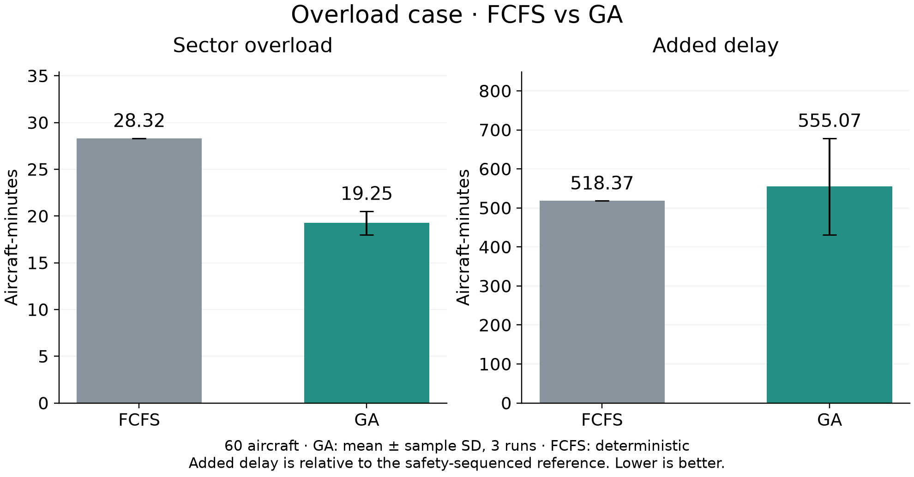

# MOSAIC case study: FCFS vs Genetic Algorithm

## Aim

Evaluate whether a Genetic Algorithm can reduce sector overload while maintaining aircraft separation and runway protection.

## System and scenarios

MOSAIC connects Centre, Approach and Tower. It simulates arrivals from upstream routes to landing and parking, and departures from stands through taxi, takeoff and their outbound routes.

- **Nominal:** 20 aircraft — 11 arrivals and 9 departures.
- **Overload:** 60 aircraft — 36 arrivals and 24 departures.

Both cases use the same sector limits and safety rules. All arrivals are airborne at startup.

## Methods

- **FCFS:** keeps departure readiness order and assigns ground delays.
- **GA:** searches departure timings, parked-departure order and eligible arrival speeds. Candidate schedules are tested in the simulator before selection.

The GA uses population 60, up to 120 generations, 6,000 fast evaluations and up to four separately counted simulator checkpoints per run. Results use seeds 11, 22 and 33. FCFS is deterministic. The GA has more control options; this compares complete traffic-management methods.

## Results

| Scenario | Method | Added delay (aircraft-min) | Sector overload (aircraft-min) | Spacing / runway |
|---|---|---:|---:|---|
| Nominal (20) | FCFS | 0.00 | 0.00 | Passed |
| Nominal (20) | GA | 0.00 | 0.00 | Passed |
| Overload (60) | FCFS | 518.37 | 28.32 | Passed |
| Overload (60) | GA | 555.07 ± 123.49 | 19.25 ± 1.27 | Passed |

GA values are mean ± sample standard deviation across three runs. Added delay is relative to a reference schedule that already includes safety sequencing. Sector overload sums aircraft above each sector's capacity over time: one excess aircraft for ten minutes equals ten aircraft-minutes.

## Main finding

In the overload case, GA reduced sector overload by **32.0%** compared with FCFS, with **36.71 additional aircraft-minutes of delay (7.1%)**. All compared executions passed the modelled spacing and runway checks. Nominal traffic required no additional regulation.

**Conclusion:** GA reduced sector overload by accepting some additional delay. It reduced, but did not eliminate, overload.

**Scope:** Two synthetic scenarios and three GA seeds provide preliminary simulation evidence. They do not establish statistical significance or real-world operational performance.

Data: [results.csv](results.csv). Reproducibility: [source_runs.json](source_runs.json). Full method and evidence: [technical report](../fcfs_ga_comparison/report.md).
