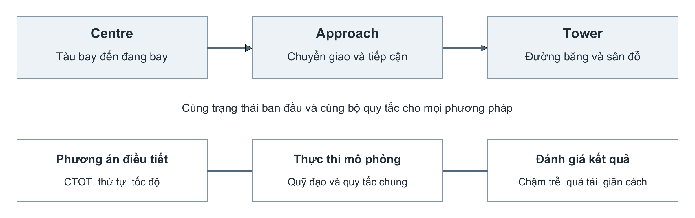
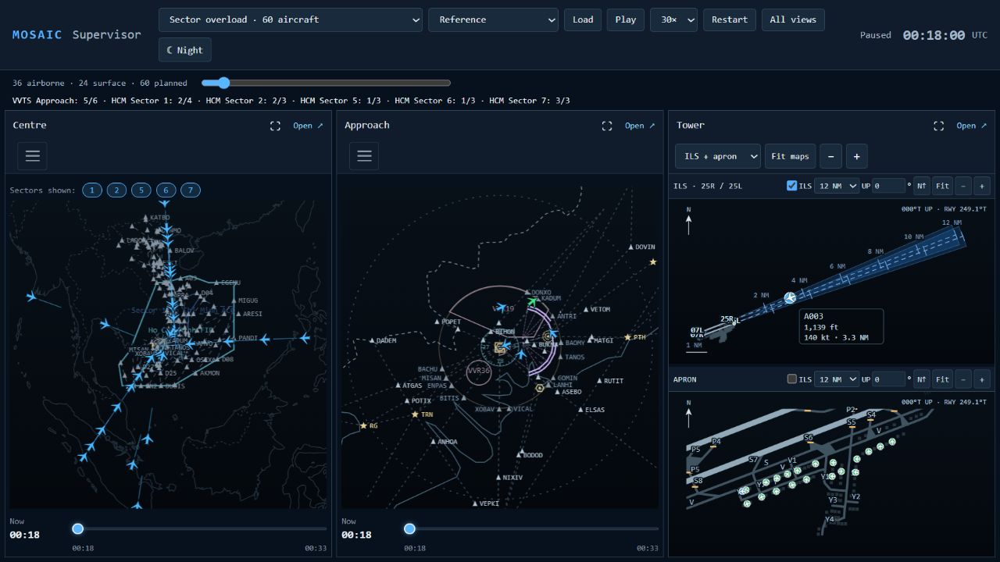
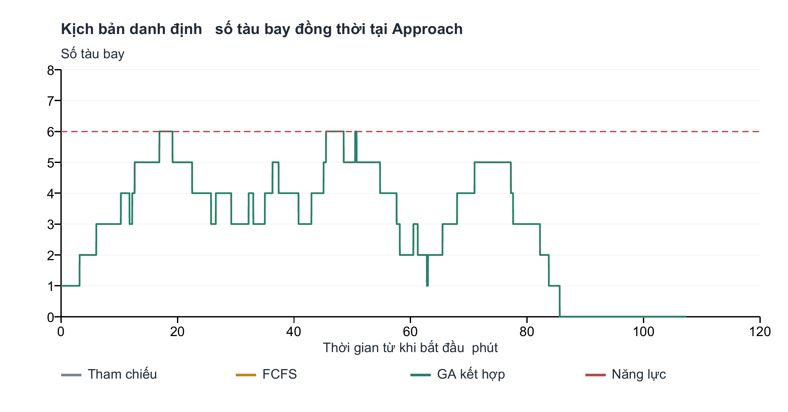
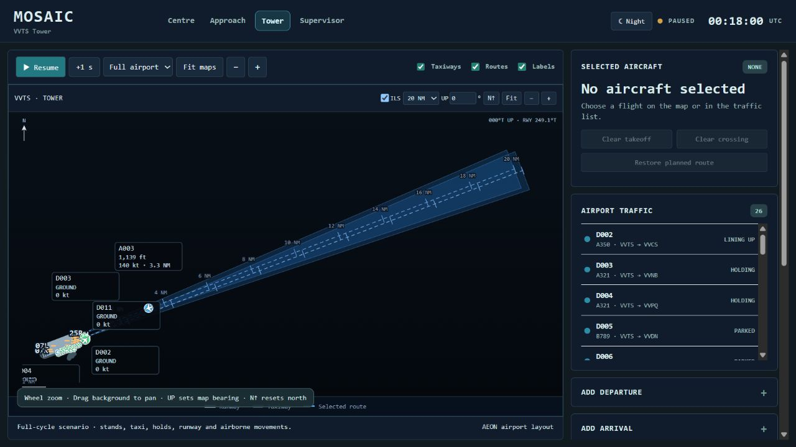
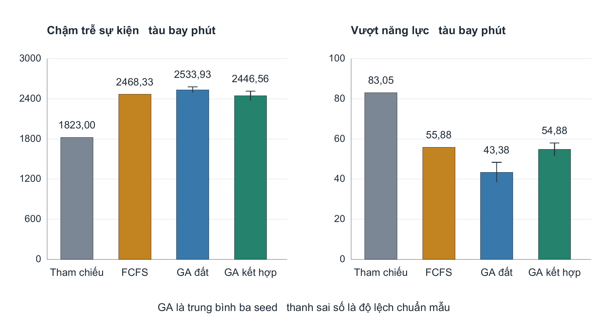
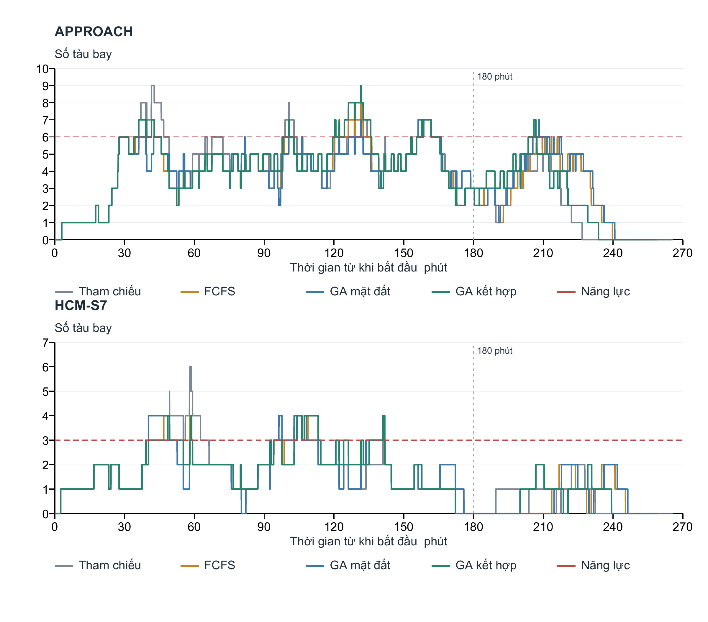
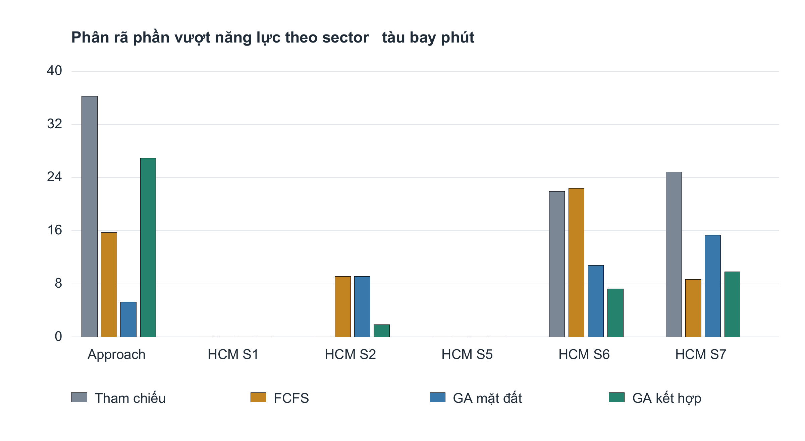
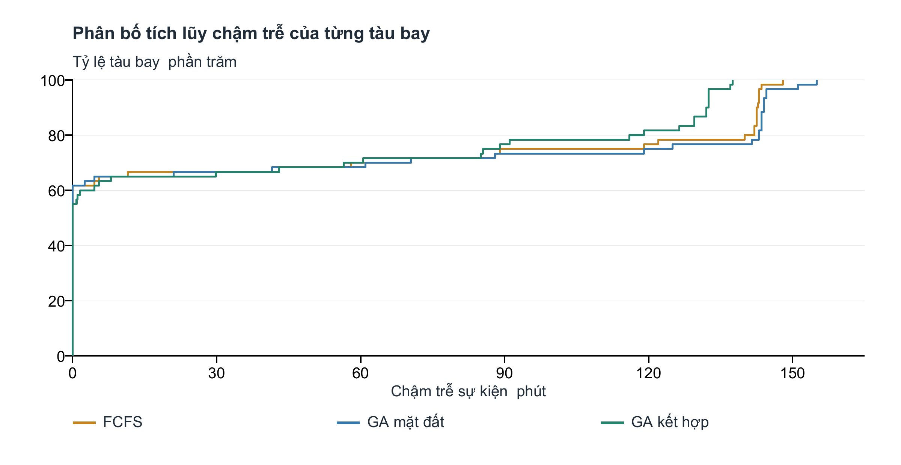
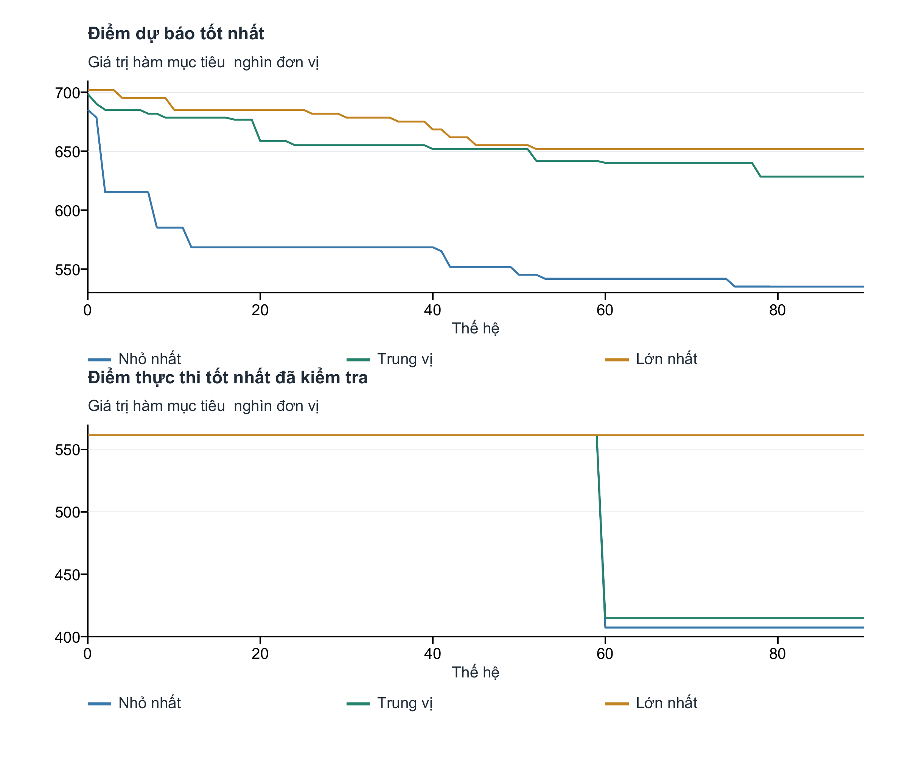

# CHƯƠNG 4
# KẾT QUẢ NGHIÊN CỨU VÀ THẢO LUẬN

Chương này trình bày kết quả đánh giá các biện pháp điều tiết luồng không lưu trong mô hình mô phỏng Tân Sơn Nhất bằng thuật toán di truyền. Hai tình huống được xem xét gồm kịch bản danh định và kịch bản quá tải. Các phương án được thực thi trên cùng hệ thống Centre, Approach và Tower để so sánh mức vượt năng lực sector, chậm trễ sự kiện và việc đáp ứng các quy tắc giãn cách đã thiết lập.

Hiệu quả được đánh giá bằng mười seed cố định và kết quả thực thi đầy đủ. Đối chứng FCFS sử dụng kết quả tốt hơn giữa hai bước điều tiết một phút và năm phút. Chương này tách lợi ích từ khởi tạo khỏi cải thiện sau khởi tạo, đồng thời giữ lại các trường hợp GA không cải thiện. Các kết luận gắn với dữ liệu tổng hợp và bộ giả định của mô phỏng.

## 4.1 Kết quả nghiên cứu

### 4.1.1 Thiết lập mô phỏng và phương pháp đánh giá

#### Phạm vi hệ thống và dữ liệu

Mô hình kết nối ba phạm vi điều hành. Centre thể hiện luồng tàu bay trên các đường bay dẫn vào khu vực Tân Sơn Nhất; Approach tiếp nhận tàu bay và tổ chức tiếp cận; Tower mô phỏng đường băng, đường lăn và vị trí đỗ. Đối với tàu bay đến, quá trình quan sát bắt đầu khi tàu bay đã ở trên không và kết thúc sau khi hạ cánh, lăn vào vị trí đỗ. Đối với tàu bay đi, mô hình bao gồm chờ tại vị trí đỗ, lăn, chờ đường băng, cất cánh và rời phạm vi theo dõi. Phạm vi này cho phép đo cả ảnh hưởng trên không và ảnh hưởng lên hoạt động mặt đất.

@source Nguồn: cấu trúc mô hình MOSAIC được sử dụng trong nghiên cứu.

Bộ dữ liệu được xây dựng từ bảng VVTS_scenarios do nhóm cung cấp và được bổ sung thời điểm, đường bay, trạng thái ban đầu cùng các thông tin mặt đất cần thiết. Đây là các kịch bản tổng hợp có điều chỉnh phục vụ thực nghiệm, không phải bản ghi đầy đủ của một ngày khai thác thực tế. Thời gian trên lịch mô phỏng là mốc quy ước để đồng bộ các chuyến bay, không phản ánh nhu cầu khai thác thực tế của sân bay vào ngày tương ứng.

Hai kịch bản giữ nguyên số tàu bay và các đặc điểm đầu vào khi chuyển giữa các phương pháp. Tất cả tàu bay đến đều hiện diện và chuyển động ngay từ đầu. Một tàu bay đi đã ở trạng thái chuẩn bị trên đường băng, các tàu bay đi còn lại ở vị trí đỗ và được đưa vào hàng chờ theo điều kiện sẵn sàng cùng khả năng tiếp nhận của mặt đất. Số tàu bay đi đang tham gia hàng chờ mặt đất được giới hạn ở bốn, trong đó tối đa một tàu bay trên đường băng. Nhờ đó, quá tải trên không không bị thể hiện bằng việc tập trung toàn bộ tàu bay đi tại điểm chờ.

@table Bảng 4.1 Đặc điểm hai kịch bản nghiên cứu
| Đặc điểm | Danh định | Quá tải |
|---|---|---|
| Tổng số tàu bay | 20 | 60 |
| Tàu bay đến | 11 | 36 |
| Tàu bay đi | 9 | 24 |
| Cửa sổ báo cáo ban đầu | 180 phút | 180 phút |
| Tàu bay đến có mặt từ đầu | 11 | 36 |
| Tàu bay đi đã chuẩn bị trên đường băng | 1 | 1 |
| Tàu bay đi còn ở vị trí đỗ | 8 | 23 |
| Số tàu bay thực hiện vòng chờ trên không | 0 | 0 |

@source Nguồn: cấu hình và trạng thái ban đầu của hai kịch bản.

Trong kịch bản quá tải, luồng đến được phân bố trên W1 qua AC và LKH, BIBAN–BITIS, PTH–BAOMY, SAPEN phía tây, NIXIV–VICAL và VTV. Số tàu bay trên các nhóm này lần lượt là 8, 7, 8, 5, 3, 3 và 2. Các đường ra của tàu bay đi gồm KADUM–BMT, LANHI–ELSAS, XOBAV–NIXIV, ANTRI–DOVIN và ANTRI–PTH, với số lượng tương ứng 8, 7, 3, 3 và 3. Cách phân bố này tạo nhiều điểm nhập và hướng thoát, thay vì dồn toàn bộ lưu lượng vào một nhánh đường bay.

#### Năng lực và quy tắc chung

Năng lực trong thực nghiệm được biểu diễn bằng số tàu bay đang bay đồng thời thuộc từng sector. Một tàu bay chỉ được tính vào sector đang chứa nó theo ranh giới ngang và lớp độ cao đã lưu. Khu vực Approach trong bán kính 40 NM được ưu tiên khi xác định phạm vi đếm. Tàu bay trên mặt đất và tàu bay ở sector khác không được cộng vào giới hạn của sector đang xét. Do đó, tổng số biểu tượng hiện trên màn hình radar có thể lớn hơn năng lực một sector mà chưa tạo ra vượt năng lực tại sector đó.

@table Bảng 4.2 Năng lực sector giả định trong thực nghiệm
| Sector | Năng lực đồng thời | Đơn vị |
|---|---|---|
| VVTS Approach | 6 | Tàu bay đang bay |
| HCM S1 | 4 | Tàu bay đang bay |
| HCM S2 | 3 | Tàu bay đang bay |
| HCM S5 | 3 | Tàu bay đang bay |
| HCM S6 | 3 | Tàu bay đang bay |
| HCM S7 | 3 | Tàu bay đang bay |

@source Nguồn: bộ tham số nghiên cứu. Các giá trị là giả định mô phỏng, không phải năng lực công bố của cơ sở điều hành.

Đại lượng ở Bảng 4.2 không quy đổi trực tiếp thành số chuyến đến trong một giờ. Giới hạn đồng thời được dùng để xác định khoảng thời gian nhiều tàu bay cùng hiện diện trong một vùng trách nhiệm và đo ảnh hưởng của điều tiết theo toàn bộ quỹ đạo.

Tất cả phương pháp sử dụng chung quy tắc bảo vệ đường băng và giãn cách. Trong mô hình, tàu bay đi chỉ bắt đầu chạy đà khi tàu bay đến trước đã thoát hoàn toàn khỏi đường băng, tàu bay đến tiếp theo còn ngoài 6 NM và thời điểm rời đất dự kiến cách lần chạm bánh tiếp theo hơn 30 giây. Khoảng cách giữa hai lần cất cánh tối thiểu là 120 giây. Các ngưỡng này là điều kiện của thực nghiệm và được giữ giống nhau trong so sánh.

Giãn cách trên không được kiểm tra theo loại cặp tàu bay và phạm vi hoạt động. Chính sách Centre sử dụng các ngưỡng nghiên cứu 10/20 NM; cặp đến–đi trong khu vực terminal sử dụng 5 NM hoặc 1.000 ft khi cả hai nằm trong 40 NM và không cao hơn 10.000 ft. Các cặp còn lại tiếp tục tuân theo chính sách tương ứng. Khoảng thời gian chuyển giao tàu bay đến tối thiểu là 120 giây. Việc không phát hiện vi phạm theo các kiểm tra này chỉ có ý nghĩa trong phạm vi mô hình đã thiết lập.

@source Nguồn: ảnh giao diện MOSAIC ở phiên bản case trước, chỉ minh họa tổ chức quan sát; không thay cho số đo của thực nghiệm mới.

#### Phương pháp đối chứng và biến quyết định

Phương án tham chiếu giữ lịch đã được mô hình sắp xếp theo quy tắc an toàn, chưa bổ sung điều tiết ATFM của thực nghiệm. Vì bản thân lịch tham chiếu đã chứa chờ và sắp xếp đường băng, chậm trễ sự kiện bằng không không đồng nghĩa tàu bay được khai thác hoàn toàn không phải chờ.

FCFS duy trì thứ tự theo mốc sẵn sàng cố định của tàu bay đi, sau nhóm tàu bay đã lăn, và lần lượt chọn CTOT sớm nhất phù hợp với các kiểm tra dự báo. Hai miền bước một phút và bước năm phút được thực thi độc lập; kết quả có J thực thi thấp hơn được dùng làm đối chứng chính. Cả hai kết quả đều được lưu, kể cả trường hợp bước năm phút tốt hơn bước một phút do sai khác giữa dự báo và thực thi. GA mặt đất tìm kiếm mức giữ đất, đồng thời cho phép đổi thứ tự các tàu bay đi còn ở vị trí đỗ. GA kết hợp mở rộng thêm điều chỉnh tốc độ trên các đoạn Centre đủ điều kiện của tàu bay đến. Tàu bay đã lăn hoặc đã tham gia thứ tự cam kết tiếp tục được ưu tiên theo bộ giải mã.

@table Bảng 4.3 Các phương án so sánh
| Phương án | Điều tiết giữ đất | Đổi thứ tự tàu bay còn đỗ | Điều chỉnh tốc độ tàu bay đến |
|---|---|---|---|
| Tham chiếu | Không bổ sung | Theo lịch tham chiếu | Không bổ sung |
| FCFS | Có | Không tối ưu lại | Không |
| GA mặt đất | Có | Có | Không |
| GA kết hợp | Có | Có | Có khi đủ điều kiện |

Miền giữ đất đề xuất là 0–60 phút, bước một phút. Miền giảm tốc độ là 0, 1, 2, 3, 5, 10 và 15%. Không phải mọi tàu bay đều có toàn bộ các lựa chọn này: tàu bay đến đã ở trên không không nhận biện pháp giữ đất; điều chỉnh tốc độ chỉ được xét trên phần quỹ đạo phù hợp. Đường bay, cấu hình năng lực và số tàu bay không phải biến được GA tự do thay đổi trong các thực nghiệm này.

So sánh GA mặt đất với FCFS là so sánh chính giữa các cấu hình có cùng nhóm biện pháp giữ đất. So sánh GA kết hợp với FCFS đánh giá lợi ích của cả cách tìm kiếm lẫn việc bổ sung biện pháp trên không. Vì phạm vi điều khiển khác nhau, không thể quy toàn bộ mức cải thiện của GA kết hợp cho riêng các toán tử di truyền.

#### Chỉ tiêu đánh giá và cấu hình thuật toán

Chậm trễ của từng tàu bay được đo bằng phần tăng dương của thời điểm thực thi so với một mốc yêu cầu cố định, chung cho mọi phương pháp. Sự kiện được dùng là cất cánh đối với tàu bay đi và chạm bánh đối với tàu bay đến. Tổng chậm trễ sự kiện được tính theo công thức (4.1), trong đó các thời điểm sử dụng đơn vị giây và kết quả quy đổi sang phút.

@equation delay 4.1

Trong công thức (4.1), N là số tàu bay; tᵢ là thời điểm sự kiện sau thực thi; rᵢ là mốc yêu cầu cố định. Đối với tàu bay đi, rᵢ là thời điểm sẵn sàng cất cánh được gán trước khi xếp lịch an toàn; đối với tàu bay đến, rᵢ là thời điểm chạm bánh của quỹ đạo không điều tiết từ đúng trạng thái ban đầu đang xét. Tổng được báo cáo bằng tàu bay-phút. Quãng đường thượng nguồn dùng để bố trí tàu bay ban đầu không được tự động tính thành chậm trễ điều tiết. Các mốc rᵢ là giả định của nghiên cứu, không phải giờ khai thác được xác minh từ dữ liệu thực tế. Chậm trễ so với lịch tham chiếu còn được lưu riêng, gồm phần tăng dương và mức thay đổi có dấu; chúng không thay thế D khi so sánh các phương án.

Phần vượt năng lực được tích lũy trên từng sector và toàn bộ thời gian mô phỏng theo công thức (4.2). Trong đó nₛ(t) là số tàu bay đang bay thuộc sector s tại thời điểm t; Cₛ là năng lực của sector; T là thời điểm kết thúc quá trình đánh giá. Hệ số 1/60 chuyển giây sang phút.

@equation excess 4.2

Ví dụ, một tàu bay vượt giới hạn trong năm phút và hai tàu bay vượt giới hạn trong hai phút tạo tổng cộng chín tàu bay-phút vượt năng lực. Chỉ tiêu E phản ánh đồng thời mức độ và thời gian quá tải; nó cung cấp thông tin khác với chỉ báo đỉnh lớn nhất. Trong triển khai, tích phân được xấp xỉ bằng tổng mẫu theo thời gian.

Với các phương án đáp ứng kiểm tra giãn cách và đường băng của mô hình, giá trị đánh giá thực thi sử dụng công thức (4.3). Dđi và Dđến lần lượt là tổng chậm trễ sự kiện của tàu bay đi và tàu bay đến theo các mốc rᵢ đã định nghĩa. Các hệ số là trọng số quy ước của nghiên cứu, không phải chi phí nhiên liệu hay chi phí tiền tệ đã được hiệu chỉnh từ thực tế.

@equation objective 4.3

Trọng số 10.000 đặt ưu tiên lớn vào giảm phần vượt năng lực. Vì vậy, thuật toán có thể chấp nhận tăng thời gian chờ của tàu bay đi để giảm E. Tuy nhiên, đây vẫn là thành phần phạt hữu hạn, không phải bảo đảm mọi sector luôn dưới giới hạn. Trong quá trình tìm kiếm, các vi phạm giãn cách, đường băng và thứ tự cam kết còn chịu một thành phần phạt riêng; kết quả công bố được lựa chọn sau khi thực thi lại trong mô phỏng.

@table Bảng 4.4 Cấu hình GA và ngân sách đánh giá
| Tham số | Giá trị sử dụng |
|---|---|
| Kích thước quần thể | 60 cá thể |
| Số thế hệ tối đa | 120 |
| Số đánh giá nhanh tối đa | 6.000 cho mỗi phương pháp và seed |
| Số lần kiểm tra thực thi tối đa | 4 cho mỗi phương pháp và seed, đếm riêng |
| Seed ngẫu nhiên | 11, 22, 33, 44, 55, 66, 77, 88, 99, 110 |
| Chọn lọc | Tournament, ba ứng viên |
| Bảo toàn cá thể | Khoảng 10%, tối thiểu hai cá thể |
| Khởi tạo | FCFS bước một phút, FCFS bước năm phút và các biến thể |
| Toán tử tìm kiếm | Đổi thứ tự tại sân đỗ, lai theo nhóm tuyến, đột biến tốc độ phối hợp, tinh chỉnh giữ đất |
| Duy trì đa dạng | Khởi động lại sau mười thế hệ không cải thiện dự báo |
| Kiểm tra cuối cùng | Thực thi quỹ đạo và kiểm tra ở bước một giây |

Đánh giá nhanh sử dụng mẫu 20 giây cho lượng chiếm dụng và một số kiểm tra cặp; quỹ đạo cùng kiểm tra cặp tàu bay đến được tính ở bước một giây. Các nghiệm được chọn tiếp tục được thực thi bằng bộ điều khiển mặt đất và trên không của mô hình. Kết quả thực thi có thể khác dự báo do thời điểm nhả đường băng, hàng chờ và điều chỉnh an toàn. Do đó, bảng kết quả chính sử dụng số đo sau thực thi, còn lịch sử dự báo chỉ phục vụ phân tích quá trình tìm kiếm.

Với GA, mỗi cấu hình được chạy theo mười seed và báo cáo trung bình cùng độ lệch chuẩn mẫu. Phương án tham chiếu và FCFS là tất định trong bộ đầu vào đang xét. Đường biểu diễn của một replay được ghi rõ là ví dụ lựa chọn; không được coi đường đó là kết quả trung bình của mười lần chạy.

#### Thiết kế quá tải có thể điều tiết

Kịch bản danh định giữ nhu cầu, mốc sẵn sàng, đường bay và trạng thái ban đầu trên không đã kiểm chứng. Lịch mặt đất của cả hai case được kiểm chứng lại sau khi sửa quy tắc nhường tại nút giao giữa tàu bay đến và đi; cùng quy tắc được áp dụng cho mọi phương pháp. Kịch bản quá tải giữ số lượng, phân bố nhóm đường bay, năng lực và quy tắc an toàn, nhưng bố trí lại thời điểm sẵn sàng cùng vị trí ban đầu. Riêng luồng đến được xây dựng sao cho không vượt năng lực tại bất kỳ sector nào trong toàn bộ quá trình. Phần quá tải xuất hiện khi luồng đi chồng lên luồng đến. Thiết kế này tạo một bài toán mà CTOT và thứ tự khởi hành thực sự có thể tác động, thay vì yêu cầu giữ đất giải quyết phần quá tải đã do toàn bộ tàu bay đang bay tạo ra.

Tất cả 36 tàu bay đến chuyển động ngay từ đầu trên các đường dẫn thượng nguồn; phần kéo dài thượng nguồn tối thiểu tương ứng 20 phút. Những tàu bay phía sau được bố trí xa hơn để bảo đảm giãn cách và năng lực, không dùng vòng chờ. Đối với tàu bay đi, một tàu bay đã tham gia thứ tự cam kết; 12 tàu bay tiếp theo có mốc sẵn sàng trong khoảng phút 20 đến phút 36,5, cách nhau 90 giây. Các tàu bay còn lại có mốc phút 50 đến phút 80, cách nhau ba phút. Nhu cầu sẵn sàng nhanh hơn khoảng cách cất cánh tối thiểu ở đợt đầu tạo hàng chờ mà không bắt buộc đưa tất cả tàu bay ra đường lăn cùng lúc.

Tàu bay còn đỗ có thể nhận CTOT bằng mốc sẵn sàng cộng mức giữ đất từ 0 đến 60 phút. Vì vậy, một chuyến phía sau có hướng ra ít bị chiếm dụng có thể được xếp sớm hơn lịch tham chiếu, trong giới hạn sẵn sàng và an toàn. Lựa chọn không can thiệp vẫn giữ sự kiện tham chiếu. Các tàu bay đã lăn không được đưa lên trước vị trí đã cam kết. Cách định nghĩa này được áp dụng giống nhau cho FCFS và GA; chỉ GA được tìm kiếm lại thứ tự của nhóm còn đỗ.

Giao thức được lưu trước khi chạy GA: 10 seed, cùng ngân sách, cùng trọng số và tiêu chí chấp nhận kịch bản dựa trên tính khả thi vật lý. Kịch bản chỉ được chấp nhận khi kiểm tra một giây không có vi phạm giãn cách hoặc đường băng, luồng đến riêng không vượt năng lực và tham chiếu kết hợp có vượt năng lực. Không sử dụng tỷ lệ thắng của GA làm điều kiện lựa chọn kịch bản. Đây là một tình huống xây dựng có chủ đích để khảo sát cơ chế điều tiết, chưa phải mẫu đại diện cho toàn bộ khai thác sân bay.

### 4.1.2 Kết quả kịch bản danh định

Kịch bản danh định kiểm tra hành vi của các phương án khi năng lực sector không bị vượt. Bảng 4.5 sử dụng số đo sau thực thi; dấu ± thể hiện độ lệch chuẩn mẫu của mười seed GA. Kết quả tham chiếu và FCFS là tất định. Giá trị D có thể dương ngay trong tham chiếu vì đã tính thời gian từ mốc sẵn sàng cố định đến cất cánh, bao gồm chờ do tổ chức an toàn và hoạt động mặt đất.

@table Bảng 4.5 Kết quả thực thi kịch bản danh định
| Phương án | D tàu bay phút | E tàu bay phút | J đơn vị | Lần đạt an toàn |
|---|---|---|---|---|
| Tham chiếu | 187,00 | 0,00 | 187,00 | 1/1 |
| FCFS mạnh | 187,00 | 0,00 | 187,00 | 1/1 |
| GA mặt đất | 187,00 ± 0,00 | 0,00 ± 0,00 | 187,00 ± 0,00 | 10/10 |
| GA kết hợp | 187,00 ± 0,00 | 0,00 ± 0,00 | 187,00 ± 0,00 | 10/10 |

@source Nguồn: thực thi một giây của toàn bộ mười seed cho mỗi cấu hình GA.

GA kết hợp có D trung bình 187,00 tàu bay-phút và E bằng 0,00. Chênh lệch D so với FCFS là 0,00 tàu bay-phút. Vì vậy, dữ liệu danh định không tạo bằng chứng về lợi ích định lượng của GA so với FCFS. Trường hợp này cần được giữ trong báo cáo để thể hiện điều kiện mà thuật toán tối ưu không mang lại cải thiện.

@source Nguồn: tái tính từ quỹ đạo thực thi một giây; các đường trùng nhau khi kết quả tương đương.

@source Nguồn: ảnh giao diện MOSAIC minh họa chế độ quan sát; không thay thế số đo của thực nghiệm mới.

Việc không cải thiện trong case danh định phù hợp với vai trò của nó như một đối chứng ít bị ràng buộc bởi năng lực sector. Một thuật toán có nhiều biến điều khiển không mặc nhiên tạo hiệu quả khi phương án đơn giản đã xử lý được nhu cầu. Khi đánh giá, cần xem phần thay đổi của lịch thực thi và lượng chiếm dụng, tránh coi số quyết định được gán nhãn điều tiết là bằng chứng về chất lượng tốt hơn.

### 4.1.3 Kết quả kịch bản quá tải

Luồng đến riêng có E bằng 0; tham chiếu kết hợp có E bằng 83,05 tàu bay-phút. Do đó, mức quá tải của case mới có quan hệ với thời điểm luồng đi cùng sử dụng sector. Bảng 4.6 cho phép đánh giá đồng thời khả năng giảm quá tải và chi phí chậm trễ, không suy ra kết quả chỉ từ tổng số tàu bay trên radar.

@table Bảng 4.6 Kết quả thực thi kịch bản quá tải
| Phương án | D tàu bay phút | E tàu bay phút | J đơn vị | Lần đạt an toàn |
|---|---|---|---|---|
| Tham chiếu | 1823,00 | 83,05 | 832323,00 | 1/1 |
| FCFS mạnh | 2468,33 | 55,88 | 561301,67 | 1/1 |
| GA mặt đất | 2533,93 ± 44,68 | 43,38 ± 4,98 | 436383,93 ± 49783,34 | 10/10 |
| GA kết hợp | 2446,56 ± 68,85 | 54,88 ± 3,18 | 551233,22 ± 31839,23 | 10/10 |

@source Nguồn: toàn bộ kết quả thực thi, không lựa chọn riêng seed thuận lợi.

So với FCFS mạnh, ga mặt đất thay đổi D trung bình 65,60 tàu bay-phút, thay đổi E -12,50 tàu bay-phút và thay đổi J -124917,74 đơn vị. Có 0/10 lần thực thi không vượt năng lực. Dấu âm ở chênh lệch thể hiện mức giảm; các chỉ tiêu còn lại vẫn phải được xem xét cùng nhau.

Tính tương đối theo FCFS, mức thay đổi E là -22,37% và mức thay đổi D là 2,66%. Đây là tỷ lệ trên trung bình của cùng bộ đầu vào, không phải xác suất GA sẽ cải thiện một tình huống khai thác bất kỳ.

So với FCFS mạnh, ga kết hợp thay đổi D trung bình -21,77 tàu bay-phút, thay đổi E -1,01 tàu bay-phút và thay đổi J -10068,45 đơn vị. Có 0/10 lần thực thi không vượt năng lực. Dấu âm ở chênh lệch thể hiện mức giảm; các chỉ tiêu còn lại vẫn phải được xem xét cùng nhau.

Tính tương đối theo FCFS, mức thay đổi E là -1,80% và mức thay đổi D là -0,88%. Đây là tỷ lệ trên trung bình của cùng bộ đầu vào, không phải xác suất GA sẽ cải thiện một tình huống khai thác bất kỳ.

@source Nguồn: trung bình và độ lệch chuẩn mẫu qua mười seed GA; FCFS dùng kết quả tốt hơn giữa hai miền bước.

Độ lệch chuẩn trong Hình 4.5 thể hiện biến động của quá trình tìm kiếm trên cùng một bộ đầu vào, không mô tả biến động nhu cầu thực tế. Nếu E đã bằng 0 ở nhiều phương án, khả năng phân biệt hiệu quả nằm ở D, J và phân bố chậm trễ. Nếu E còn dương, cần báo cáo rõ mức còn lại; không gọi phương án là đáp ứng năng lực chỉ vì nó tốt hơn tham chiếu.

@source Nguồn: replay thực thi được chọn theo J thấp nhất, TEAM_GROUND_33 và TEAM_MIXED_44. Các đường này là ví dụ được chọn; bảng trung bình vẫn sử dụng toàn bộ mười seed.

Hình 4.6 cho thấy thời điểm tác động của điều tiết: dịch CTOT thay đổi khoảng thời gian tàu bay đi cùng chiếm dụng sector với luồng đến. Hai sector được chọn theo mức đóng góp vào quá tải của tham chiếu, không theo mức cải thiện của GA. Việc kiểm tra toàn bộ hành trình tiếp tục đến khi tàu bay cuối kết thúc, nhằm tránh tạo mức giảm giả do dời lưu lượng ra ngoài cửa sổ ba giờ.

#### Phân bố quá tải theo sector

@table Bảng 4.7 Phần vượt năng lực theo sector của các replay minh họa
| Sector | Tham chiếu | FCFS mạnh | GA mặt đất | GA kết hợp |
|---|---|---|---|---|
| APPROACH | 36,25 | 15,70 | 5,25 | 26,90 |
| HCM-S1 | 0,00 | 0,00 | 0,00 | 0,00 |
| HCM-S2 | 0,00 | 9,13 | 9,13 | 1,88 |
| HCM-S5 | 0,00 | 0,00 | 0,00 | 0,00 |
| HCM-S6 | 21,93 | 22,38 | 10,78 | 7,23 |
| HCM-S7 | 24,87 | 8,67 | 15,30 | 9,82 |

@source Nguồn: tích lũy lượng chiếm dụng một giây của các replay; đơn vị tàu bay-phút. Tổng được tính từ số chưa làm tròn.

@source Nguồn: cùng các replay với Bảng 4.7.

Phân rã theo sector giúp xác định phương án đã giải quyết đúng nơi phát sinh vấn đề hay chỉ chuyển sự tập trung sang khu vực khác. Không thể dùng một sector có cải thiện để thay cho kết quả toàn hệ thống. Với luồng đến riêng đã khả thi, phần vượt sau thực thi của các phương án phản ánh giới hạn của lịch luồng đi được chọn, sai khác dự báo hoặc tác động bổ sung của điều chỉnh tốc độ; nó không được loại khỏi mẫu đánh giá.

### 4.1.4 So sánh với đối chứng mạnh và phân bố chậm trễ

FCFS bước một phút và năm phút có cùng thứ tự yêu cầu, quy tắc an toàn, mốc sẵn sàng và giới hạn giữ đất 60 phút. Bước nhỏ hơn tạo nhiều lựa chọn hơn nhưng không bảo đảm kết quả thực thi tốt hơn một thuật toán tham lam với bước lớn. Vì vậy, nghiên cứu chọn theo J thực thi, không lựa chọn đối chứng yếu hơn để làm tăng tỷ lệ cải thiện của GA.

@table Bảng 4.8 Hai độ phân giải FCFS trong kịch bản quá tải
| Cấu hình | D tàu bay phút | E tàu bay phút | J đơn vị |
|---|---|---|---|
| FCFS_FINE | 2468,33 | 55,88 | 561301,67 |
| FCFS_COARSE | 2523,83 | 61,77 | 620190,50 |

Đối chứng chính của case quá tải là FCFS_FINE. Cả hai kế hoạch FCFS được cung cấp cho GA ở bước khởi tạo. Do đó, nếu GA chỉ giữ lại kế hoạch FCFS tốt hơn thì phần lợi ích này thuộc về lựa chọn khởi tạo, chưa phải cải thiện nhờ tìm kiếm sau khởi tạo.

Giảm tổng chậm trễ không có nghĩa mọi chuyến bay đều được hưởng lợi. Việc đổi thứ tự có thể đưa chuyến có hướng ra còn chỗ lên trước, đồng thời tăng chờ cho chuyến khác. Vì vậy, Hình 4.8 biểu diễn toàn bộ phân bố chậm trễ theo chuyến của các replay đã nêu, bao gồm cả tàu bay đến không bị điều chỉnh. Phân bố không phải khoảng tin cậy của mười seed.

@source Nguồn: mốc rᵢ cố định và thời điểm sự kiện sau thực thi; dùng cùng các replay đã nêu ở Hình 4.6.

Trong hàm mục tiêu, một phút chậm trễ trên không được đặt trọng số bằng hai phút chậm trễ mặt đất. Đây là lựa chọn ưu tiên nghiên cứu. Nó không phải phép quy đổi nhiên liệu hoặc chi phí kinh tế. Chỉ tiêu công bằng chưa được đưa thành một mục tiêu tối ưu riêng; cần tiếp tục kiểm tra chậm trễ lớn nhất và độ phân tán nếu muốn giới hạn việc một số chuyến phải chịu phần lớn tác động.

Mốc sự kiện đường băng và mốc hoàn tất hành trình được thống kê riêng. Một tàu bay đến đã chạm bánh nhưng chưa vào vị trí đỗ chưa được xem là kết thúc hành trình đầy đủ. Tương tự, một tàu bay đi đã cất cánh nhưng chưa rời đoạn Centre đang theo dõi vẫn thuộc quá trình thực thi. Bảng kết quả ba giờ trên giao diện thể hiện số sự kiện đường băng, không được diễn giải thành số hành trình đã hoàn tất.

@table Bảng 4.9 Hoàn tất hành trình trong các replay quá tải
| Phương án | Hành trình xong trước 180 phút | Phút hoàn tất cuối |
|---|---|---|
| Tham chiếu | 46/60 | 251,85 |
| FCFS mạnh | 43/60 | 264,85 |
| GA mặt đất | 42/60 | 265,85 |
| GA kết hợp | 44/60 | 258,85 |

### 4.1.5 Biến động giữa seed và đóng góp sau khởi tạo

Mỗi seed sử dụng cùng đầu vào và giới hạn tính toán. Bảng 4.10 và Bảng 4.11 giữ toàn bộ mười kết quả của từng cấu hình GA. Cột giảm J sau khởi tạo bằng J thấp nhất của các FCFS được kiểm tra lúc khởi tạo trừ J thực thi cuối. Giá trị bằng 0 nghĩa là không tìm được nghiệm thực thi tốt hơn điểm khởi tạo; nó không đồng nghĩa quá trình dự báo không thay đổi.

@table Bảng 4.10 Toàn bộ seed GA mặt đất trong kịch bản quá tải
| Seed | D tàu bay phút | E tàu bay phút | J đơn vị | Giảm J sau khởi tạo |
|---|---|---|---|---|
| 11 | 2561,62 | 41,97 | 422228,28 | 139073,38 |
| 22 | 2561,62 | 41,97 | 422228,28 | 139073,38 |
| 33 | 2561,62 | 40,47 | 407228,28 | 154073,38 |
| 44 | 2561,62 | 40,47 | 407228,28 | 154073,38 |
| 55 | 2476,33 | 47,90 | 481476,33 | 79825,33 |
| 66 | 2561,62 | 40,47 | 407228,28 | 154073,38 |
| 77 | 2561,62 | 40,47 | 407228,28 | 154073,38 |
| 88 | 2561,62 | 40,47 | 407228,28 | 154073,38 |
| 99 | 2463,33 | 43,80 | 440463,33 | 120838,33 |
| 110 | 2468,33 | 55,88 | 561301,67 | 0,00 |

@table Bảng 4.11 Toàn bộ seed GA kết hợp trong kịch bản quá tải
| Seed | D tàu bay phút | E tàu bay phút | J đơn vị | Tàu bay giảm tốc | Giảm J sau khởi tạo |
|---|---|---|---|---|---|
| 11 | 2468,33 | 55,88 | 561301,67 | 0 | 0,00 |
| 22 | 2468,33 | 55,88 | 561301,67 | 0 | 0,00 |
| 33 | 2468,33 | 55,88 | 561301,67 | 0 | 0,00 |
| 44 | 2250,60 | 45,83 | 460617,17 | 4 | 100684,50 |
| 55 | 2468,33 | 55,88 | 561301,67 | 0 | 0,00 |
| 66 | 2468,33 | 55,88 | 561301,67 | 0 | 0,00 |
| 77 | 2468,33 | 55,88 | 561301,67 | 0 | 0,00 |
| 88 | 2468,33 | 55,88 | 561301,67 | 0 | 0,00 |
| 99 | 2468,33 | 55,88 | 561301,67 | 0 | 0,00 |
| 110 | 2468,33 | 55,88 | 561301,67 | 0 | 0,00 |

Với ga mặt đất, 9/10 seed cải thiện J thực thi sau khởi tạo; mức giảm trung bình là 124917,74 đơn vị. Mức này là đóng góp của quá trình tìm kiếm lai sau khởi tạo, gồm tiến hóa, tinh chỉnh cục bộ và phản hồi thực thi. Thiết kế hiện tại chưa tách riêng tác dụng của từng toán tử, nên không quy toàn bộ chênh lệch cho lai ghép hoặc đột biến.

Với ga kết hợp, 1/10 seed cải thiện J thực thi sau khởi tạo; mức giảm trung bình là 10068,45 đơn vị. Mức này là đóng góp của quá trình tìm kiếm lai sau khởi tạo, gồm tiến hóa, tinh chỉnh cục bộ và phản hồi thực thi. Thiết kế hiện tại chưa tách riêng tác dụng của từng toán tử, nên không quy toàn bộ chênh lệch cho lai ghép hoặc đột biến.

@source Nguồn: giá trị nhỏ nhất trung vị và lớn nhất theo thế hệ trên mười seed. Điểm thực thi chỉ cập nhật khi có kiểm tra đầy đủ; giữa các lần kiểm tra và sau khi một seed dừng giữ nguyên giá trị cuối đã biết.

Hai phần Hình 4.9 trả lời hai câu hỏi khác nhau. Điểm dự báo cho biết bộ tìm kiếm đang đánh giá thế nào trên quỹ đạo và bảng kiểm tra đã tính trước. Điểm thực thi cho biết những kế hoạch đã đưa qua bộ điều khiển thực sự đạt kết quả gì. Một đường dự báo giảm không đủ để khẳng định phương án khai thác tốt hơn. Khi dự báo và thực thi khác nhau, kết luận sử dụng thực thi.

Các thay đổi tốc độ bị bộ kiểm tra gỡ bỏ được lưu theo chuyến; chậm trễ do bộ điều khiển bổ sung cũng được tính vào D cuối. Không loại một seed khỏi thống kê vì nó phải sửa kế hoạch. Điều này làm rõ chi phí của việc tìm nghiệm khó thực thi và tránh chỉ trình bày kết quả đẹp của bộ đánh giá nhanh.

@table Bảng 4.12 Ngân sách tìm kiếm đã sử dụng trong kịch bản quá tải
| Phương án | Đánh giá nhanh mỗi seed | Tổng kiểm tra thực thi | Thời gian tìm kiếm trung bình giây |
|---|---|---|---|
| GA mặt đất | 6000–6000 | 40 | 68,78 |
| GA kết hợp | 6000–6000 | 40 | 74,88 |

Thời gian bộ điều phối thí nghiệm quá tải ghi nhận là 27,08 phút, tính từ khi đã có bảng quỹ đạo, gồm kiểm tra, tìm kiếm và xuất replay. Thời gian dựng bảng riêng không nằm trong số đo này. Bộ nhớ đệm có thể tái sử dụng một kế hoạch giống nhau giữa nhiều seed; số checkpoint được thuật toán yêu cầu và số mô phỏng độc lập thực sự chạy vì thế không luôn bằng nhau. Ngân sách 6.000 chỉ tính đánh giá nhanh, không bao gồm toàn bộ chi phí tính toán. Các số đo thời gian phụ thuộc máy chạy và không phải thời gian đáp ứng được bảo đảm cho điều hành thực tế.

## 4.2 Thảo luận

### 4.2.1 Điều kiện tạo cơ hội cải thiện

GA có không gian tạo lợi ích khi có nhiều quyết định còn thay đổi được và chi phí sử dụng tài nguyên phụ thuộc thứ tự. Trong case này, các hướng ra sử dụng sector ở thời điểm khác nhau. FCFS phải giữ thứ tự yêu cầu; GA có thể chọn một tàu bay còn đỗ, đã sẵn sàng, có hướng ra ít bị chiếm dụng để thực hiện trước. Khi điều tiết tốc độ đủ sớm, thời điểm tàu bay đến chuyển giao và nhập sector cũng có thể thay đổi trong giới hạn giãn cách.

Nhu cầu vượt năng lực tự nó chưa đủ để GA tốt hơn. Nếu quá tải hoàn toàn do các tàu bay đã ở trên không và không có biện pháp điều khiển phù hợp, thay CTOT tàu bay đi không giải quyết được nguyên nhân. Nếu mọi tàu bay dùng cùng tuyến, cùng thời gian chiếm dụng và cùng ưu tiên, lợi ích đổi thứ tự có thể nhỏ. Case danh định và case có các hướng ra khác nhau cung cấp hai điều kiện đối chiếu cho cơ chế này.

Việc xây dựng kịch bản có chủ đích là phù hợp để khảo sát một giả thuyết, nhưng phải công bố cách xây dựng. Tỷ lệ cải thiện thu được chỉ mô tả tình huống đã chọn. Muốn kết luận cho một lớp bài toán, cần sinh nhiều bộ nhu cầu độc lập theo quy tắc đã chốt trước và đánh giá cả trường hợp GA không thắng.

### 4.2.2 Vai trò của đối chứng và mốc chậm trễ

Đối chứng mạnh giúp phân biệt lợi ích của thuật toán với lợi ích của một thay đổi triển khai. Trong nghiên cứu này, cả hai phương pháp đều được chọn CTOT từ cùng mốc sẵn sàng; GA không được độc quyền đưa chuyến bay lên sớm hơn lịch đã xếp. FCFS một phút và năm phút được thực thi đầy đủ rồi chọn kết quả tốt hơn. GA nhận cả hai nghiệm làm khởi tạo, do đó lợi ích giữ lại nghiệm tốt hơn được nhận diện riêng.

Mốc chậm trễ cũng ảnh hưởng trực tiếp kết luận. Nếu chỉ tính phần tăng so với một lịch tham chiếu đã chứa chờ, một kế hoạch đưa nhiều chuyến lên sớm có thể không được ghi nhận đúng. Nếu tính quãng bay thượng nguồn được bổ sung thành chậm trễ, D lại bị tăng bởi cách khởi tạo. Định nghĩa rᵢ riêng cho tàu bay đi và đến tránh hai sai lệch này, trong khi vẫn giữ nguyên rᵢ giữa các phương pháp của cùng case.

Các kết quả trước và sau khi thay cách đo không được gộp vào cùng một bảng trung bình. Hồ sơ cũ được lưu lại để kiểm tra thay đổi, còn kết quả chương này dùng một phiên bản đầu vào và bộ đánh giá xác định. Việc thay đổi kịch bản cũng làm mất ý nghĩa của một phép so sánh trực tiếp tỷ lệ cải thiện giữa hai phiên bản case.

### 4.2.3 Liên hệ với các nghiên cứu trước

Hansen xem xét tìm kiếm di truyền cho lập lịch tàu bay đến và phân bổ đường băng [8]. Phạm vi nghiên cứu ở đây bao gồm thêm lượng chiếm dụng sector và quá trình mặt đất, nhưng giữ cố định nhiều đặc điểm đường bay. Do khác biến quyết định, dữ liệu và chỉ tiêu, các tỷ lệ cải thiện không thể so sánh trực tiếp.

Biểu diễn theo chuyến bay và khai thác nhóm tuyến có liên hệ với hướng thiết kế biểu diễn theo đặc trưng bài toán của Xiao, Cai và Abbass [6]. Tuy nhiên, triển khai MOSAIC không tái hiện thuật toán HybrID trong bài báo. Thực nghiệm hiện tại đánh giá một cấu hình GA lai trong mô hình riêng, không chứng minh ưu thế so với các thuật toán được công bố trong tài liệu tham khảo.

Tách điểm dự báo khỏi kết quả thực thi làm rõ vai trò của mô phỏng trong đánh giá ATFM. Một nghiệm tốt theo bảng quỹ đạo dịch thời gian có thể phải chờ thêm vì đường băng hoặc hàng chờ vật lý. Vì vậy, nghiên cứu ghi nhận cả quá trình sửa phương án và thời điểm thực tế sau thực thi, thay vì dùng điểm thích nghi làm kết quả cuối cùng.

### 4.2.4 Giới hạn và khả năng tái lập

Hai case sử dụng nhu cầu tổng hợp; giới hạn sector, tốc độ và hành vi mặt đất chưa được hiệu chuẩn đầy đủ bằng khai thác thực tế. Các ngưỡng an toàn là giả định chung của mô phỏng, không thay thế tiêu chuẩn hoặc hướng dẫn điều hành. Không phát hiện vi phạm trong bước kiểm tra một giây chỉ có ý nghĩa đối với quỹ đạo và quy tắc đã mô hình hóa.

Mười seed đo biến động tìm kiếm trên cùng bộ nhu cầu, không phải mười ngày khai thác độc lập. Nghiên cứu chưa chứng minh ý nghĩa thống kê hoặc khả năng khái quát cho mọi mức nhu cầu, thời tiết hay cấu hình đường băng. Việc tách cải thiện sau khởi tạo vẫn chưa thay thế thí nghiệm loại bỏ từng thành phần để đo đóng góp riêng của toán tử di truyền, tìm kiếm cục bộ và phản hồi thực thi.

Mô hình chưa tối ưu đường bay tùy ý, cấu hình năng lực hoặc biện pháp giữ đất cho các tàu bay đến đã ở trên không. Tốc độ được điều chỉnh trên đoạn đủ điều kiện; việc thay tốc độ vẫn phải giữ được giãn cách và quy tắc chuyển giao. Không sử dụng vòng chờ trên không nên không có cơ sở lượng hóa tiết kiệm nhiên liệu nhờ giảm holding.

Để tái lập, cần giữ nguyên tệp đầu vào, hàm lượng chiếm dụng, mốc rᵢ, phiên bản bộ đánh giá, seed và ngân sách. Hồ sơ lưu mã băm đầu vào, toàn bộ kết quả theo seed, hai FCFS, checkpoint và replay cuối. Các biểu đồ minh họa chỉ dùng replay được ghi rõ, còn mọi nhận định về trung bình đều lấy từ toàn bộ tập chạy.

# CHƯƠNG 5
# KẾT LUẬN VÀ KIẾN NGHỊ

## 5.1 Kết luận

### 5.1.1 Kết quả đồ án

Đồ án xây dựng mô hình điều tiết luồng không lưu kết nối Centre, Approach và Tower tại Tân Sơn Nhất. Tàu bay đi được theo dõi từ vị trí đỗ, qua lăn, chờ, cất cánh và đường ra; tàu bay đến được theo dõi từ thượng nguồn đến khi hạ cánh và vào vị trí đỗ. Các phương án được đánh giá bằng cùng quy tắc thực thi và kiểm tra một giây.

Hai kịch bản gồm danh định 20 tàu bay và quá tải 60 tàu bay, giữ 36 tàu bay đến cùng 24 tàu bay đi ở case quá tải. Kịch bản mới có luồng đến riêng không vượt năng lực; quá tải phát sinh khi kết hợp luồng đi. Thiết kế tạo điều kiện khảo sát tác động của CTOT, thứ tự tàu bay còn đỗ và điều chỉnh tốc độ từ sớm.

Trong danh định, GA mặt đất và FCFS cho cùng D và E. Trong quá tải, GA mặt đất có D trung bình 2533,93 ± 44,68 tàu bay-phút và E trung bình 43,38 ± 4,98 tàu bay-phút; FCFS mạnh tương ứng 2468,33 và 55,88. Mức vượt năng lực giảm 22,37%, đổi lại D tăng 2,66%. Có 9/10 seed cải thiện J thực thi sau khởi tạo.

GA kết hợp có D trung bình 2446,56 ± 68,85 tàu bay-phút và E trung bình 54,88 ± 3,18 tàu bay-phút. Với ngân sách hiện tại, thêm điều chỉnh tốc độ chưa tạo kết quả tốt hơn cấu hình mặt đất theo J trung bình. Kết quả sử dụng toàn bộ mười seed và vẫn còn vượt năng lực; lợi ích được hiểu là một sự đánh đổi theo trọng số nghiên cứu.

### 5.1.2 Ưu điểm

Mô hình cho phép quan sát tác động của điều tiết xuyên suốt trên không và mặt đất, đếm năng lực đúng sector và tính đến phần lưu lượng ở cuối quá trình. Việc dùng đối chứng nhiều độ phân giải, cùng mốc sẵn sàng và kiểm tra thực thi đầy đủ giúp đánh giá công bằng hơn. Kết quả từng seed và đóng góp sau khởi tạo có thể kiểm tra lại theo hồ sơ lưu.

### 5.1.3 Hạn chế

Dữ liệu và năng lực còn mang tính giả định. Hai case chưa đại diện cho thực tế khai thác; mười seed chỉ phản ánh biến động tìm kiếm trên cùng đầu vào. Những seed giữ lại nghiệm khởi tạo không được xem là bằng chứng rằng tiến hóa tạo thêm lợi ích. Mô hình chưa lượng hóa chi phí kinh tế, nhiên liệu hoặc đầy đủ các yếu tố tác nghiệp.

## 5.2 Kiến nghị

### 5.2.1 Hướng ứng dụng

Hệ thống phù hợp với giảng dạy, nghiên cứu tình huống và phân tích phương án trước mô phỏng. Khi trình bày, cần nêu rõ dữ liệu tổng hợp, mức quá tải còn lại, chậm trễ theo từng loại tàu bay và vai trò của đối chứng. Việc phát triển thành công cụ hỗ trợ điều hành cần dữ liệu thực tế, hiệu chuẩn và thẩm định chuyên môn.

### 5.2.2 Hướng phát triển

Ưu tiên tiếp theo là sinh nhiều bộ nhu cầu độc lập theo mức tải và phân bố hướng bay đã quy định trước, đồng thời khảo sát năng lực, trọng số và điều kiện sẵn sàng. Nên đánh giá độ nhạy của kết quả thay vì thay kịch bản sau khi đã biết seed nào thuận lợi.

Về thuật toán, cần thực nghiệm loại bỏ từng thành phần như khởi tạo nhiều độ phân giải, đổi thứ tự, tinh chỉnh cục bộ và phản hồi thực thi. Có thể bổ sung mục tiêu công bằng và giới hạn chậm trễ từng chuyến, sau đó mở rộng sang cập nhật theo thời gian với cùng ngân sách và dữ liệu cho các phương pháp.

Về dữ liệu, cần thống nhất mốc sẵn sàng, rời vị trí đỗ, cất cánh, chuyển giao, chạm bánh và vào vị trí đỗ. Việc bổ sung các mốc thực tế sẽ giúp thay giả định hiện tại bằng tham số được hiệu chỉnh và đánh giá hiệu quả trên phạm vi khai thác rộng hơn.

# TÀI LIỆU THAM KHẢO SỬ DỤNG TRONG CHƯƠNG 4 VÀ 5

[6] M. Xiao, K. Cai và H. A. Abbass, “Hybridized encoding for evolutionary multi-objective optimization of air traffic network flow: A case study on China,” Transportation Research Part E: Logistics and Transportation Review, tập 115, tr. 35–55, 2018. DOI: 10.1016/j.tre.2018.04.011.

[8] J. V. Hansen, “Genetic search methods in air traffic control,” Computers & Operations Research, tập 31, số 3, tr. 445–459, 2004.

Nguồn số liệu nghiên cứu: MOSAIC phiên bản full-route-ready-bank-ga-9; danh định 20261031T023558Z-9f40de82; quá tải 20261031T023600Z-dbf5f3f6. Giao thức controllable-bank-1 ngày 31 tháng 10 năm 2026; seed 11, 22, 33, 44, 55, 66, 77, 88, 99 và 110. Kết quả cũ được lưu riêng và không gộp với lần đánh giá này.
