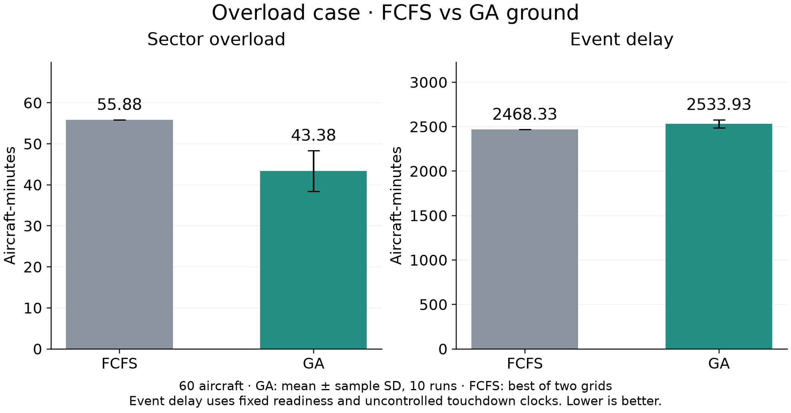

# MOSAIC case study: FCFS vs Genetic Algorithm

## Aim

Evaluate whether a Genetic Algorithm can reduce sector overload while maintaining aircraft separation and runway protection.

## System and scenarios

MOSAIC connects Centre, Approach and Tower. It simulates arrivals from upstream routes to landing and parking, and departures from stands through taxi, takeoff and their outbound routes.

- **Nominal:** 20 aircraft — 11 arrivals and 9 departures.
- **Overload:** 60 aircraft — 36 arrivals and 24 departures.

Both cases use the same sector limits and safety rules. All arrivals are airborne at startup.

## Methods

- **FCFS:** keeps departure readiness order and assigns ground delays.
- **GA ground:** searches departure timings and parked-departure order, using the same ground-control action set as FCFS. A separate mixed extension also adjusts eligible arrival speeds; its results remain in the full report. Candidate schedules are tested in the simulator before selection.

The GA uses population 60, up to 120 generations, 6,000 fast evaluations and up to four separately counted simulator checkpoints per run. Results use ten fixed seeds 11, 22, …, 110. FCFS is the better native objective of its one-minute and five-minute grids. The primary comparison uses the two ground-control methods; the mixed extension is reported separately.

## Results

| Scenario | Method | Event delay (aircraft-min) | Sector overload (aircraft-min) | Spacing / runway |
|---|---|---:|---:|---|
| Nominal (20) | FCFS | 187.00 | 0.00 | Passed |
| Nominal (20) | GA ground | 187.00 ± 0.00 | 0.00 | Passed |
| Overload (60) | FCFS | 2468.33 | 55.88 | Passed |
| Overload (60) | GA ground | 2533.93 ± 44.68 | 43.38 ± 4.98 | Passed |

GA values are mean ± sample standard deviation across ten runs. Event delay uses fixed departure readiness and uncontrolled arrival touchdown times from identical initial states. Sector overload sums aircraft above each sector's capacity over time: one excess aircraft for ten minutes equals ten aircraft-minutes.

## Main finding

Sector excess changed from 55.88 to 43.38 aircraft-minutes (GA minus FCFS: -12.50). Event delay changed from 2468.33 to 2533.93 aircraft-minutes (GA minus FCFS: +65.60). All compared executions passed the modelled spacing and runway checks. The nominal case is reported separately; waiting already present in the reference is included in its event-delay clock.

**Conclusion:** GA reduced sector excess with the reported delay trade-off. Residual sector overload remains.

**Scope:** Two synthetic scenarios and ten GA seeds provide simulation evidence for this traffic. Arrival-only overload is zero in the revised case; excess is created by overlapping departures. Improvements after initialization are reported separately in the technical report. These experiments do not establish statistical significance or real-world operational performance.

Data: [results.csv](results.csv). Reproducibility: [source_runs.json](source_runs.json). Full method and evidence: [technical report](../fcfs_ga_comparison/report.md).
